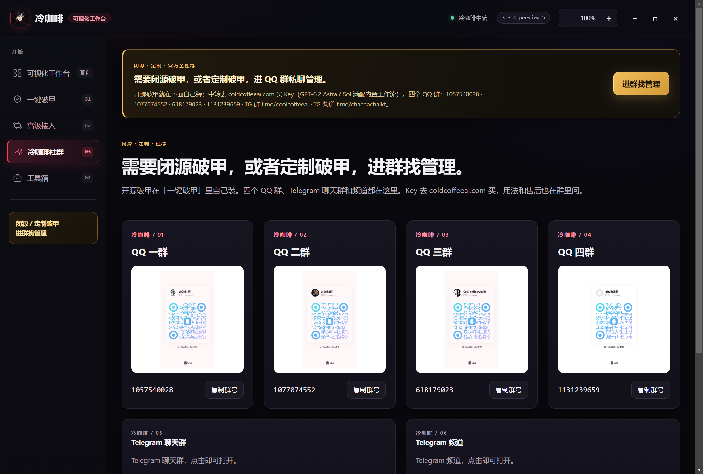
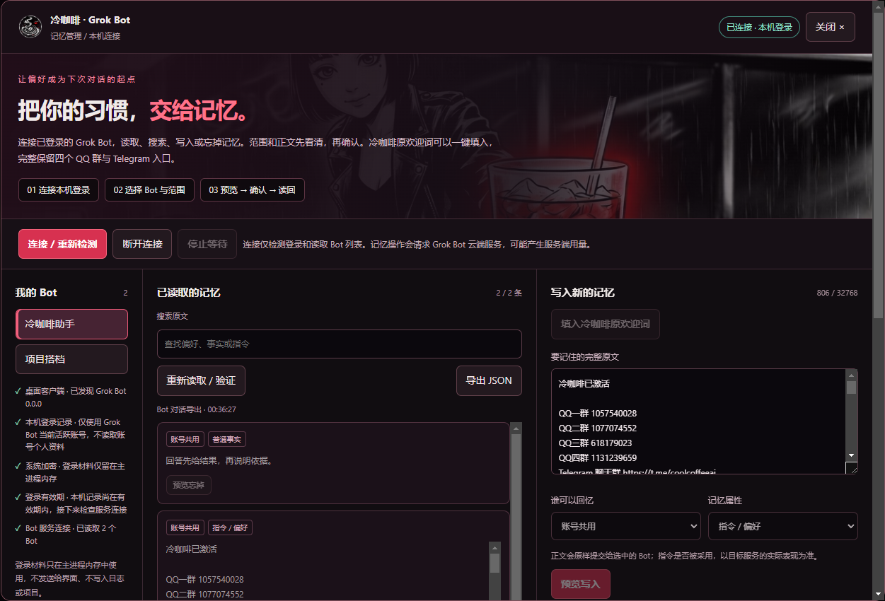
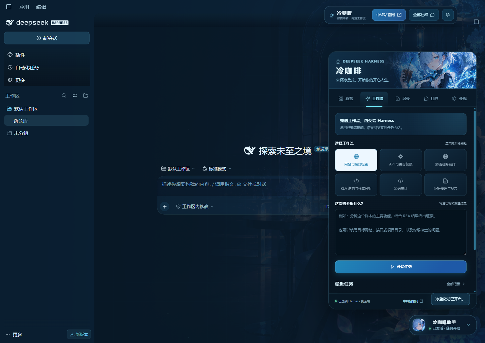
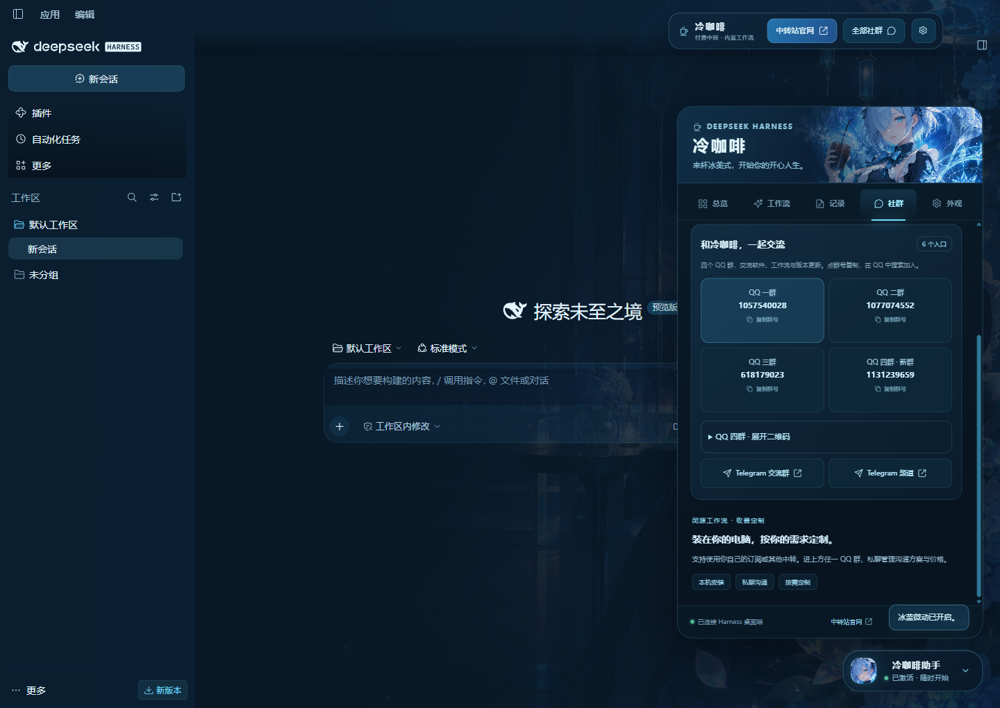
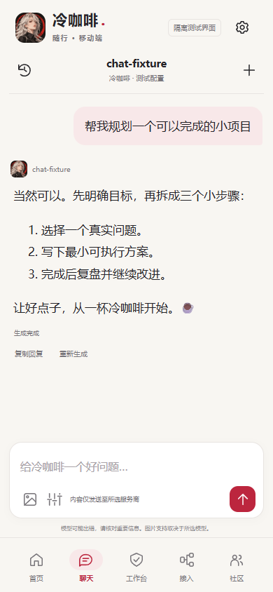
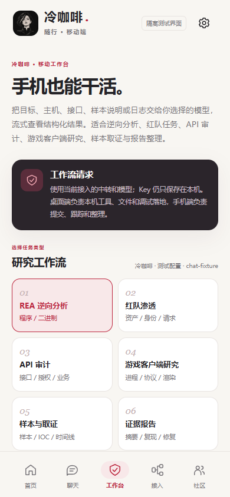
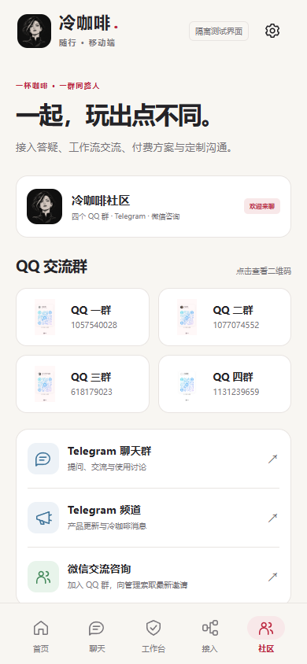

  
  

  <h1>冷咖啡 · GPT-6.2 Astra / Sol</h1>
  
<strong>核心主推 GPT-6.2 Astra / Sol · 官方付费中转 · 收费闭源破甲与专属定制 · 16 入口全模型一键工作台</strong>

  
去 <a href="https://coldcoffeeai.com/"><strong>coldcoffeeai.com</strong></a> 买 Key 即可满血接入冷咖啡中转内置工作流；需要装到本机的<strong>收费闭源破甲 / 定制破甲</strong>，直接进四个 QQ 群或 Telegram 联系管理。软件同步升级 <strong>GLM 5.4、Claude Fable 5.2、Gemini 4、Kimi K3.1 Pro、MiniMax M3.1 Flash、豆包 2.1</strong> 与 <strong>OpenCode</strong>。

  
<a href="https://coldcoffeeai.com/"><strong>🔥 开通冷咖啡中转 ↗</strong></a> &nbsp;·&nbsp; <a href="#冷咖啡服务"><strong>💎 闭源与定制破甲 ↓</strong></a> &nbsp;·&nbsp; <a href="#冷咖啡社群"><strong>💬 四个 QQ 群 & TG 社群 ↓</strong></a> &nbsp;·&nbsp; <a href="#下载"><strong>⬇ 下载安装 ↓</strong></a>

  
<a href="#软件界面">新版桌面界面</a> · <a href="#一键安装目标">16 个安装入口</a> · <a href="#可视化路由">布偶猫可视化路由</a> · <a href="#opencode">OpenCode 接入</a> · <a href="#deepseek-harness">DeepSeek 插件</a> · <a href="#安卓手机端">Android 手机端</a> · <a href="#ios手机端">iPhone / iOS</a>

  
桌面 3.3.0-preview.5 · Android 3.3.0-preview.6 · iOS 开发版 3.3.0-preview.6 · 官网 <a href="https://coldcoffeeai.com/">coldcoffeeai.com</a> · TG 群 <a href="https://t.me/coolcoffeeai">t.me/coolcoffeeai</a> · TG 频道 <a href="https://t.me/chachachalkf">t.me/chachachalkf</a>

<table id="模型焦点" class="model-spotlight">
<tr><th align="left" width="50%">✦ 核心旗舰 · GPT-6.2 Astra</th><th align="left" width="50%">✦ 核心旗舰 · GPT-6.2 Sol</th></tr>
<tr><td><strong>复杂工程与深度推理主力。</strong>接入冷咖啡中转读取模型目录后，自动排在首位一键启用，搭配内置工作流满血开工。</td><td><strong>高响应日常编码与高频代理主力。</strong>与 Astra 并列首屏推荐区，按任务需求随手秒切，省时高效。</td></tr>
<tr><td colspan="2"><strong>全模型同步更新：</strong>同步支持 <strong>GLM 5.4（<code>glm-5.4</code>）</strong>、<strong>Claude Fable 5.2</strong>、<strong>Gemini 4（Carbon / Neon / Hydrogen / Argon）</strong>、<strong>DeepSeek v4.1 Flash 10.17版本</strong>、<strong>Grok 4.7</strong>、<strong>Kimi K3.1 Pro</strong>、<strong>MiniMax M3.1 Flash</strong>、<strong>豆包 2.1</strong> 等全线最新型号。填 Key → 读模型 → 选中发送，保留服务商返回准确 ID。<a href="docs/RELAY-API.md">中转接入教程 ↗</a></td></tr>
</table>

<h2 id="冷咖啡服务">冷咖啡核心服务 · 付费中转、闭源破甲与专属定制</h2>
<blockquote>

<strong>🚀 官方付费中转：去 <a href="https://coldcoffeeai.com/">coldcoffeeai.com</a> 买 Key → 贴入冷咖啡工作台或手机端 → 读取 GPT-6.2 Astra / Sol → 直接开工。</strong>

中转站已内置工作流体验，不用折腾复杂配置，电脑（Windows / macOS / Linux）与手机（Android / iPhone）全端通用，也兼容自行添加其他中转商。

</blockquote>
<table>
<tr><th align="left" width="24%">服务项目</th><th align="left" width="50%">核心亮点与交付方式</th><th align="left" width="26%">直达入口</th></tr>
<tr><td><strong>🔥 冷咖啡付费 API 中转</strong></td><td>主打 <strong>GPT-6.2 Astra / GPT-6.2 Sol</strong> 及全线最新旗舰模型，中转内置工作流体验；按官网方案计费，顾客填自己的 Key 即刻使用。</td><td><a href="https://coldcoffeeai.com/"><strong>访问 coldcoffeeai.com 买 Key ↗</strong></a></td></tr>
<tr><td><strong>💎 收费闭源破甲（本机版）</strong></td><td>独立交付并安装到顾客自己电脑的闭源破甲工作流；不挑上游，可搭配你现有的官方订阅号或任意中转使用，效果更稳更完整。</td><td><a href="#冷咖啡社群"><strong>进 QQ 群私聊管理开通 ↓</strong></a></td></tr>
<tr><td><strong>🛠️ 专属定制闭源工作流</strong></td><td>按你的具体业务、逆向/安全/自动化场景一对一沟通方案、报价、专属流程编写与长期维护。</td><td><a href="#冷咖啡社群"><strong>进群找管理聊需求与报价 ↓</strong></a></td></tr>
<tr><td><strong>💬 官方四 QQ 群 & TG</strong></td><td><strong>QQ 一群 <code>1057540028</code></strong> · <strong>QQ 二群 <code>1077074552</code></strong> · <strong>QQ 三群 <code>618179023</code></strong> · <strong>QQ 四群 <code>1131239659</code></strong>；同步开放 Telegram 聊天群与官方更新频道。</td><td><a href="https://t.me/coolcoffeeai">TG 聊天群 ↗</a> · <a href="https://t.me/chachachalkf">TG 频道 ↗</a></td></tr>
</table>

说明：安卓 / iOS 客户端的 GPL 开源代码范围与独立收费闭源本机交付完全分开，闭源服务不包含把移动端 GPL 衍生代码闭源化。需要微信群或微信沟通请进下方 QQ 群联系管理获取。

使用说明与免责声明（展开查看中英双语条款）

<blockquote>

<strong>⚠️ 免责声明 · Disclaimer</strong>

<strong>严禁将本项目用于任何违法违纪活动。</strong>本项目仅供合法、合规的学习、研究和在你本人有权操作的环境里使用。包括但不限于：未经授权的入侵、攻击、渗透、窃取数据；诈骗、洗钱、传播恶意程序；生成或传播违法有害内容；侵犯他人隐私、知识产权和其他合法权益；违反所在地法律法规或第三方平台、模型服务的使用条款。

使用者须自行遵守所在国家和地区的法律法规，以及相关软件和服务的使用条款。使用本项目产生的一切行为和后果，由使用者自行承担，与项目作者及贡献者无关。如果你不同意以上内容，请不要下载、安装或使用本项目。

<strong>This project must NOT be used for any illegal or unlawful activity.</strong> It is provided only for lawful and compliant learning, research, and use in environments you are authorized to operate. Prohibited uses include, without limitation: unauthorized intrusion, attacks, penetration, or data theft; fraud, money laundering, or distributing malware; generating or spreading illegal or harmful content; infringing others' privacy, intellectual property, or other legal rights; and violating applicable laws or the terms of use of third-party platforms and model services.

You are solely responsible for complying with the laws and regulations of your jurisdiction and with the terms of the software and services you use. All actions and consequences arising from the use of this project are borne entirely by the user, and the authors and contributors accept no liability. If you do not agree, do not download, install, or use this project.

</blockquote>

<h2 id="软件界面">全新「暗夜绯红」桌面软件 · 实机界面</h2>

<strong>整套桌面端全面重设计：</strong>统一暗夜黑金绯红视觉体系、大字号清晰层级、100%–200% 原生缩放不溢出；首屏直推 <strong>GPT-6.2 Astra / Sol</strong>、<strong>coldcoffeeai.com 付费中转</strong>、<strong>闭源/定制破甲</strong>与<strong>四个 QQ 群 / Telegram 入口</strong>，一键破甲页完整保留 <strong>16 个安装入口（原 15 模型席位 + OpenCode）</strong>。

 <strong>可视化首页 · GPT-6.2 Astra / Sol + 中转、闭源定制与全社群一键直达</strong>

 <strong>一键破甲 · 16 个安装入口同一网格（全模型同步至 2026 最新版）</strong>

<table>
<tr><td width="50%" align="center"> <strong>冷咖啡中转 · GPT-6.2 Astra / Sol 直连配置</strong></td><td width="50%" align="center"> <strong>官方社群 · 四个 QQ 群与 Telegram 聊天群 / 频道</strong></td></tr>
<tr><td width="50%" align="center"> <strong>客户端向导 · Codex / Claude / DeepSeek / OpenCode</strong></td><td width="50%" align="center"> <strong>原生启动页 · 暗夜绯红统一品牌视觉</strong></td></tr>
</table>

<strong>OpenCode 中转接入：</strong>在「一键破甲」16 格网格末尾可直接安装 OpenCode 技能；在「可视化工作台」点击「开始接入」选择 OpenCode、中转和可用模型，先预览配置再写入，写入前自动备份并支持一键恢复。使用 OpenCode 时保持工作台本机网关运行。

<strong>激活方法：</strong>安装完成后重启目标软件，在对话框里单独发送<strong>「冷咖啡」</strong>，完整欢迎词（含四个 QQ 群与 Telegram 聊天群、频道）原样保留。DeepSeek Harness 也可在右下角助手的启动框发送同一口令。

以上全部为新版桌面端在隔离测试环境中的实机截图，使用合成测试数据、未填入真实个人 Key；社群卡片与二维码为真实官方资源，点击任意图片可看原图。

<h2 id="可视化路由">可视化路由 · 布偶猫轨迹与上下文透明观测</h2>

<strong>接入简单，路由全透明。</strong>贴入冷咖啡中转 Key 读取模型，一键写入配置并自动备份。原创中古手绘风蓝眼布偶猫沿实际请求线路连续往返，端点转身全程可见；支持主备与嵌套路由、失败自动切备用线路、上下文分类面积图与历史回放，也可随时暂停动效。

 独立隔离测试资料 · 展示真实多分支路由与决策时间线，零个人 Key

<table>
<tr><th align="left">实时路由观测</th><th align="left">上下文与多端接入</th></tr>
<tr><td>主备与嵌套路由、命中/排除原因、每次尝试的状态码与耗时、布偶猫轨迹回放</td><td>上下文分类面积图、工具调用统计、缓存命中率、剩余窗口与一键展开明细</td></tr>
<tr><td>路由组编辑、成员排序、会话保持、历史记录筛选与实时跟随最新</td><td>Codex、Claude Code、DeepSeek Harness 与 <a href="#opencode">OpenCode</a> 一键配置预览、备份写入与恢复</td></tr>
</table>

展开查看：模型搜索与接入预览截图

独立测试数据界面：按名称或中转快速搜索模型，确认前可核对将更新的本机配置文件。

<h2 id="grok-bot-memory">Grok Bot · 冷咖啡云端记忆管理</h2>

在「一键破甲」的 Grok Bot 卡片直接点「管理 Bot 云端记忆」，连接本机已登录客户端，选择 Bot 读取、搜索或导出 JSON 记忆；写入或遗忘前均先预览确认，内置原版完整冷咖啡欢迎词（含四个 QQ 群与 Telegram 群/频道）。<a href="docs/GROK-BOT-MEMORY.md">查看使用说明 ↗</a>

<h2 id="deepseek-harness">DeepSeek Harness · 冰蓝插件工作空间</h2>

支持官方 DeepSeek Harness Web 与 Windows Desktop：整套冰蓝界面皮肤、动态开屏、右下角助手，复用内置 REA 与 reverse-skill 的六大研究工作流（Web/API 安全检查、权限审计、分阶段编排、REA 逆向、源码审计、证据报告），原启动词「冷咖啡」与全部社群入口完整保留。<a href="docs/DEEPSEEK-PLUGIN.md">查看插件说明 ↗</a>

<table>
<tr><td width="50%"></td><td width="50%"></td></tr>
<tr><td align="center">Windows Desktop · 六大研究工作流</td><td align="center">Windows Desktop · 四 QQ 群、Telegram 与中转入口</td></tr>
</table>

<h2 id="安卓手机端">Android 手机端 · 随时随地连中转、跑工作台</h2>

<strong>口袋里的冷咖啡：</strong>全中文大字号界面，优先推荐 <strong>GPT-6.2 Astra / Sol</strong>（同步识别 GLM-5.4、Claude Fable 5.2、Gemini 4），支持冷咖啡付费中转与自定义服务商。除了流式聊天，还内置<strong>六类移动研究工作台</strong>（REA 逆向、红队渗透、API 审计、游戏客户端研究、样本取证、证据报告），内置社区直达四 QQ 群与 Telegram。<a href="docs/ANDROID.md">安卓安装教程 ↗</a> · <a href="docs/MOBILE-PRIVACY.md">数据与隐私说明 ↗</a>

<table>
<tr><td width="25%" align="center"> <strong>接入首页</strong></td><td width="25%" align="center"> <strong>模型随手切</strong></td><td width="25%" align="center"> <strong>六类工作台</strong></td><td width="25%" align="center"> <strong>社群与定制</strong></td></tr>
</table>

移动端兼容模块基于 Chatbox Community Edition 公开代码二次开发，界面与安卓外壳原创，以 GPL-3.0 公开对应源码（<a href="https://github.com/3641397194-wq/gpt6-Astra/blob/main/mobile/THIRD_PARTY_NOTICES.md">来源与变更</a> · <a href="https://github.com/3641397194-wq/gpt6-Astra/blob/main/mobile/LICENSE">GPL 许可</a>）。冷咖啡是独立项目，非 Chatbox 官方出品。

<h2 id="ios手机端">iPhone / iOS 手机端 · SwiftUI 原生客户端</h2>

与安卓端同一套接入与工作台能力：Keychain 加密保存 Key、GPT-6.2 Astra / Sol 与最新全模型识别、流式聊天、六类研究工作台、社群与定制咨询入口。源码位于 <a href="https://github.com/3641397194-wq/gpt6-Astra/tree/main/mobile-ios"><code>mobile-ios/</code></a>（GPL-3.0-only），已通过 macOS CI 模拟器测试与无签名构建。<a href="docs/IOS-MARKETING.md">iOS 构建与签名流程 ↗</a>

<table>
<tr><td width="25%" align="center"> <strong>接入中转</strong></td><td width="25%" align="center"> <strong>流式对话</strong></td><td width="25%" align="center"> <strong>移动工作台</strong></td><td width="25%" align="center"> <strong>社群与服务</strong></td></tr>
</table>

<h2 id="下载">下载安装 · 全平台安装包</h2>

<strong>桌面 3.3.0-preview.5 · Android 3.3.0-preview.6：</strong><a href="https://github.com/3641397194-wq/gpt6-Astra/releases/tag/v3.3.0-preview.5">本版下载页 ↗</a> · <a href="https://github.com/3641397194-wq/gpt6-Astra/releases">全部历史版本 ↗</a>。所有公开下载均来自 GitHub Release Assets，请核对对应版本 SHA256SUMS。

<table id="已发布安装包">
<tr><th align="left">系统</th><th align="left">版本</th><th align="left">说明</th><th align="left">下载安装包</th></tr>
<tr><td><strong>Windows</strong></td><td><code>3.3.0-preview.5</code></td><td>16 个安装入口，含 OpenCode（x64 免安装）</td><td><a href="https://github.com/3641397194-wq/gpt6-Astra/releases/download/v3.3.0-preview.5/ColdCoffee-Workbench-Windows-3.3.0-preview.5-x64.exe">免安装 .exe ↗</a></td></tr>
<tr><td><strong>macOS Apple 芯片</strong></td><td><code>3.3.0-preview.5</code></td><td>16 个安装入口，含 OpenCode（arm64）</td><td><a href="https://github.com/3641397194-wq/gpt6-Astra/releases/download/v3.3.0-preview.5/ColdCoffee-Workbench-macOS-arm64-3.3.0-preview.5.dmg">.dmg ↗</a> · <a href="https://github.com/3641397194-wq/gpt6-Astra/releases/download/v3.3.0-preview.5/ColdCoffee-Workbench-macOS-arm64-3.3.0-preview.5.zip">.zip ↗</a></td></tr>
<tr><td><strong>macOS Intel</strong></td><td><code>3.3.0-preview.5</code></td><td>16 个安装入口，含 OpenCode（x64）</td><td><a href="https://github.com/3641397194-wq/gpt6-Astra/releases/download/v3.3.0-preview.5/ColdCoffee-Workbench-macOS-x64-3.3.0-preview.5.dmg">.dmg ↗</a> · <a href="https://github.com/3641397194-wq/gpt6-Astra/releases/download/v3.3.0-preview.5/ColdCoffee-Workbench-macOS-x64-3.3.0-preview.5.zip">.zip ↗</a></td></tr>
<tr><td><strong>Linux</strong></td><td><code>3.3.0-preview.5</code></td><td>16 个安装入口，含 OpenCode（x86_64）</td><td><a href="https://github.com/3641397194-wq/gpt6-Astra/releases/download/v3.3.0-preview.5/ColdCoffee-Workbench-Linux-x86_64-3.3.0-preview.5.AppImage">.AppImage ↗</a> · <a href="https://github.com/3641397194-wq/gpt6-Astra/releases/download/v3.3.0-preview.5/ColdCoffee-Workbench-Linux-amd64-3.3.0-preview.5.deb">.deb ↗</a></td></tr>
<tr><td><strong>Android 手机</strong></td><td><code>3.3.0-preview.6</code></td><td>安卓客户端，自定义中转与六类工作台</td><td><a href="https://github.com/3641397194-wq/gpt6-Astra/releases/download/android-v3.3.0-preview.6/ColdCoffee-Mobile-Android-3.3.0-preview.6.apk">安卓安装包 .apk ↗</a></td></tr>
<tr><td><strong>iPhone / iOS</strong></td><td><code>3.3.0-preview.6 开发版</code></td><td>SwiftUI 原生客户端，需 Xcode / Apple 签名</td><td><a href="https://github.com/3641397194-wq/gpt6-Astra/releases/download/ios-v3.3.0-preview.6/ColdCoffee-iOS-Source-3.3.0-preview.6.zip">iOS 源码 .zip ↗</a> · <a href="docs/IOS-MARKETING.md">构建流程 ↗</a></td></tr>
</table>

<a href="https://github.com/3641397194-wq/gpt6-Astra/releases/download/android-v3.3.0-preview.6/ColdCoffee-Mobile-Source-3.3.0-preview.6.zip"><strong>安卓客户端对应源码 .zip ↗</strong></a> · <strong>iOS 开发附件：</strong><a href="https://github.com/3641397194-wq/gpt6-Astra/releases/download/ios-v3.3.0-preview.6/ColdCoffee-iOS-Unsigned-3.3.0-preview.6.zip">无签名 .app ↗</a> · <a href="https://github.com/3641397194-wq/gpt6-Astra/releases/download/ios-v3.3.0-preview.6/SHA256SUMS-iOS.txt">iOS SHA-256 校验 ↗</a>。

源码运行与本地打包命令

<pre><code>cd desktop
npm ci
npm start

# 打包各平台安装包
npm run pack:win    # Windows portable .exe
npm run pack:mac    # macOS .dmg + .zip
npm run pack:linux  # Linux .AppImage + .deb</code></pre>

<h2 id="上手使用">四步快速上手</h2>
<ol>
<li><strong>开通冷咖啡中转（推荐）：</strong>去 <a href="https://coldcoffeeai.com/">coldcoffeeai.com</a> 买好 Key，在电脑或手机端贴入 Key，读取 <strong>GPT-6.2 Astra / Sol</strong> 等模型即可使用内置工作流。</li>
<li><strong>下载并打开工作台：</strong>选择对应系统安装包打开；macOS 首次如遇提示请右键图标选「打开」。</li>
<li><strong>一键破甲：</strong>在「一键破甲」勾选你电脑上装好的软件按一下即可，写前自动备份、随时一键卸载还原，同时附带 94 项完整技能与脚本库（<a href="docs/UPSTREAM-SKILLS.md">技能与校验说明</a>）。</li>
<li><strong>发送激活口令：</strong>重启目标软件，在对话框单独发送<strong>「冷咖啡」</strong>；如需<strong>收费闭源破甲或专属定制</strong>，直接进下方 QQ 群私聊管理。</li>
</ol>

<h2 id="一键安装目标">16 个一键安装入口（2026 最新模型全同步）</h2>

桌面端在同一张卡片网格内提供 <strong>16 个安装入口</strong>（保留原 15 个模型席位，第 16 项为 OpenCode 客户端入口）。所有模型名称已同步至 2026 年 11 月最新官方版本，底层配置路径与备份兼容完全不变。

<table id="安装入口列表">
<tr><th align="left">#</th><th align="left">模型 / 软件</th><th align="left">Windows 路径</th><th align="left">macOS / Linux 路径</th><th align="left">主文件</th></tr>
<tr><td>01</td><td><strong>GPT-6.2 Astra / Sol · Codex</strong></td><td><code>%USERPROFILE%\.codex</code></td><td><code>~/.codex</code></td><td><code>prompts/cha-codex.md</code>，另写 <code>AGENTS.md</code> 和 <code>config.toml</code></td></tr>
<tr><td>02</td><td><strong>Claude Fable 5.2 / 全模型支持</strong></td><td><code>%USERPROFILE%\.claude</code></td><td><code>~/.claude</code></td><td><code>CLAUDE.md</code></td></tr>
<tr><td>03</td><td>Grok 4.7</td><td><code>%USERPROFILE%\.grok</code></td><td><code>~/.grok</code></td><td><code>AGENTS.md</code></td></tr>
<tr><td>04</td><td>DeepSeek v4.1 Flash 10.17版本</td><td><code>%USERPROFILE%\.dsh</code></td><td><code>~/.dsh</code></td><td><code>skills/cha-deepseek/SKILL.md</code></td></tr>
<tr><td>05</td><td><strong>GLM 5.4全模型支持</strong></td><td><code>%USERPROFILE%\.glm</code>，有 ZCode 时用 <code>%USERPROFILE%\.zcode</code></td><td><code>~/.glm</code>，有 ZCode 时用 <code>~/.zcode</code></td><td><code>GLM.md</code></td></tr>
<tr><td>06</td><td><strong>Gemini 4 全模型支持</strong></td><td><code>%USERPROFILE%\.gemini</code></td><td><code>~/.gemini</code></td><td><code>GEMINI.md</code></td></tr>
<tr><td>07</td><td><strong>豆包 2.1</strong></td><td><code>%LOCALAPPDATA%\Doubao\User Data\Default\.doubao\agent_mode\workspace\.user_skills</code></td><td>macOS <code>~/Library/Application Support/Doubao/...</code>，Linux <code>~/.local/share/Doubao/...</code></td><td><code>cha-doubao/SKILL.md</code></td></tr>
<tr><td>08</td><td><code translate="no">WorkBuddy</code></td><td><code>%USERPROFILE%\.workbuddy</code></td><td><code>~/.workbuddy</code></td><td><code>skills/cha-workbuddy/SKILL.md</code></td></tr>
<tr><td>09</td><td><code translate="no">Cursor</code></td><td><code>%USERPROFILE%\.cursor</code></td><td><code>~/.cursor</code></td><td><code>rules/cha-cursor.mdc</code> 和 <code>skills/cha-cursor/SKILL.md</code></td></tr>
<tr><td>10</td><td><strong>MiniMax M3.1 Flash</strong></td><td><code>%USERPROFILE%\.config\mimocode</code></td><td><code>~/.config/mimocode</code></td><td><code>skills/cha-mimo/SKILL.md</code></td></tr>
<tr><td>11</td><td><strong>Kimi K3.1 Pro</strong></td><td><code>%USERPROFILE%\.kimi-code</code></td><td><code>~/.kimi-code</code></td><td><code>skills/cha-kimi/SKILL.md</code></td></tr>
<tr><td>12</td><td>Grok Bot</td><td><code>%USERPROFILE%\.grok\skills</code></td><td><code>~/.grok/skills</code></td><td><code>coldcoffee-grok-bot/SKILL.md</code></td></tr>
<tr><td>13</td><td>Claude Duet</td><td><code>%USERPROFILE%\.claude\skills</code></td><td><code>~/.claude/skills</code></td><td><code>coldcoffee-claude-duet/SKILL.md</code></td></tr>
<tr><td>14</td><td>ChatGPT Dot</td><td><code>%USERPROFILE%\.codex\skills</code></td><td><code>~/.codex/skills</code></td><td><code>coldcoffee-chatgpt-dot/SKILL.md</code></td></tr>
<tr><td>15</td><td>Meta Muse</td><td>选择实际 Skills 目录</td><td>选择实际 Skills 目录</td><td><code>coldcoffee-meta-muse/SKILL.md</code></td></tr>
<tr><td>16</td><td><a href="#opencode">OpenCode</a>（客户端）</td><td>原网格中的客户端卡片</td><td>原网格中的客户端卡片</td><td>中转配置另行设置：<code>opencode.json</code> 或 <code>opencode.jsonc</code></td></tr>
</table>

写入仅限所选数据根，写前自动备份、写后逐文件哈希核对。已支持格式的客户端（含 <code translate="no">Cursor</code> 的 <code>mcp.json</code>）自动合并本机 REA / IDA 连接。

<h2 id="工具箱">原创工具箱与 IDA Pro 9.x 联动</h2>

工作台内置 16 项原创网络扫描、HTTP/网站测试、PE/ELF 二进制分析、补丁副本与文本编码工具，并附带 IDA Pro 9.x 简体中文插件与本机 IDA MCP 联动（<code>http://127.0.0.1:13337/mcp</code>）。<a href="docs/original-toolbox.md">查看完整工具箱说明 ↗</a>

<h2 id="冷咖啡社群">冷咖啡官方社群 · 四个 QQ 群 + Telegram 聊天群与频道</h2>

<strong>🔥 中转买 Key / 充值、收费闭源破甲、专属定制工作流、用法与售后，全部在这里直接对接管理！</strong>

中转官网：<a href="https://coldcoffeeai.com/"><strong>https://coldcoffeeai.com/</strong></a> &nbsp;·&nbsp; Telegram 聊天群：<a href="https://t.me/coolcoffeeai"><strong>https://t.me/coolcoffeeai</strong></a> &nbsp;·&nbsp; Telegram 频道：<a href="https://t.me/chachachalkf"><strong>https://t.me/chachachalkf</strong></a>（需要微信沟通请进 QQ 群私聊管理获取）。

<table>
<tr><th>QQ 一群</th><th>QQ 二群</th><th>QQ 三群</th><th>QQ 四群 · 新群</th></tr>
<tr><td align="center"></td><td align="center"></td><td align="center"></td><td align="center"></td></tr>
<tr><td align="center"><code>1057540028</code></td><td align="center"><code>1077074552</code></td><td align="center"><code>618179023</code></td><td align="center"><code>1131239659</code></td></tr>
</table>
<table align="center">
<tr><th align="center" width="300">✈️ Telegram 聊天群（交流 / 咨询）</th><th align="center" width="300">📢 Telegram 官方频道（发版 / 通知）</th></tr>
<tr><td align="center"><a href="https://t.me/coolcoffeeai"><strong><code>t.me/coolcoffeeai</code> ↗</strong></a></td><td align="center"><a href="https://t.me/chachachalkf"><strong><code>t.me/chachachalkf</code> ↗</strong></a></td></tr>
</table>

<a href="https://github.com/3641397194-wq/gpt6-Astra/blob/main/LICENSE">桌面及自有代码许可证</a> · <a href="https://github.com/3641397194-wq/gpt6-Astra/blob/main/mobile/LICENSE">安卓客户端 GPL-3.0</a> · <a href="https://github.com/3641397194-wq/gpt6-Astra/blob/main/THIRD_PARTY_NOTICES.md">开源许可与第三方声明</a>

<strong>冷咖啡 · GPT-6.2 Astra / Sol</strong> — 来杯冰美式，把想法直接做出来。

