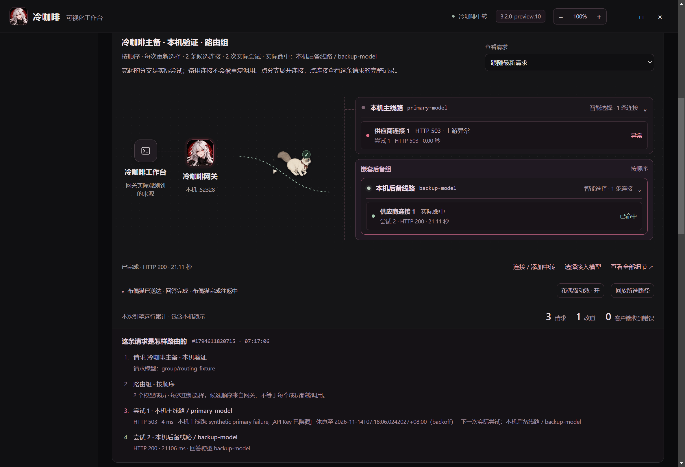
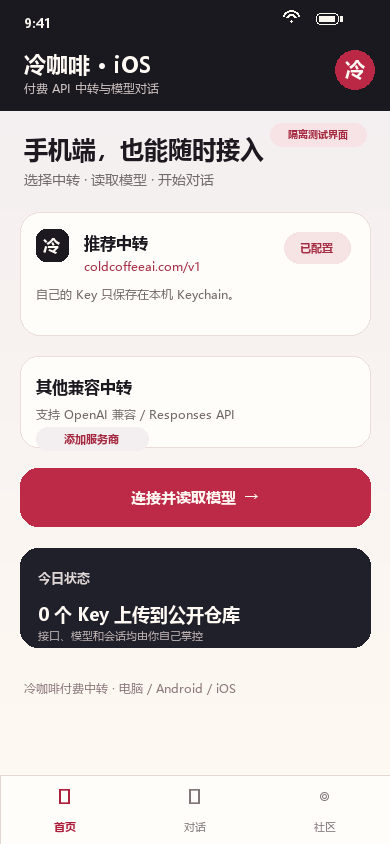

  
  

    <h1>冷咖啡工作台</h1>
    
电脑配模型，手机随时聊。

    
在电脑上为 OpenCode、Codex 等客户端配置中转，查看请求实际走过的线路。Android 和 iPhone 也能用自己的 Key 连接模型。

    
<a class="button primary" href="#opencode"><strong>查看 OpenCode 接入</strong></a> <a class="button secondary" href="#下载">下载客户端</a>

    
<strong>OpenCode 开发预览</strong> · 已发布安装包为 <code>3.3.0-preview.3</code>

  

  

    <h2 id="opencode">给 OpenCode 配一个中转</h2>
    
在桌面工作台的中转配置里选择 OpenCode。支持冷咖啡和自选兼容中转，沿用工作台的模型目录、配置预览与恢复流程。

  

  

    

      <ol class="setup-steps">
        <li><strong>填入 API 地址和自己的 Key</strong> 选择冷咖啡或添加你使用的中转。</li>
        <li><strong>读取并选择模型</strong> 使用中转返回的完整模型 ID，保留其中的服务商前缀。</li>
        <li><strong>检查配置并确认写入</strong> 查看目标文件，写入前创建备份。需要撤回时可从备份恢复。</li>
      </ol>
      
OpenCode 接入随本次桌面开发预览提供，下载区的 <code>3.3.0-preview.3</code> 安装包尚未包含该入口。

    

    

      
      
OpenCode 桌面接入界面 · 隔离预览

    

  

  

    <h2>每次请求走哪条线，直接看。</h2>
    
查看命中线路、主备切换与尝试耗时。布偶猫跟随实际线路移动，还能暂停动效或回看历史路径。

  

  

    
    
桌面路由视图 · 合成测试服务商

  

  
<a href="docs/RELAY-API.md">桌面中转教程</a> · <a href="docs/DEEPSEEK-PLUGIN.md">DeepSeek Harness 插件</a> · <a href="docs/GROK-BOT-MEMORY.md">Grok Bot 记忆管理</a> · <a href="docs/original-toolbox.md">原创工具箱</a>

  

    <h2>手机上，也能用自己的中转。</h2>
    
选择服务商，读取可用模型，开始流式对话。两端都提供会话记录、移动工作台和冷咖啡社群。

  

  

    

      <h3 id="安卓手机端">Android</h3>
      
下载 APK 后安装。冷咖啡与其他兼容中转均可添加。

      

        
        
      

      
<a href="#下载">下载 Android APK</a> · <a href="docs/ANDROID.md">安卓使用说明</a>

    

    

      <h3 id="ios手机端">iPhone / iOS</h3>
      
提供 SwiftUI 源码与无签名开发构建。尚未在 App Store 或 TestFlight 上架。

      

        
        
      

      
<a href="#下载">获取 iOS 开发附件</a> · <a href="docs/IOS-MARKETING.md">iOS 构建说明</a>

    

  

  
Android 图为隔离测试界面，iPhone 图取自模拟器。<a href="docs/MOBILE-PRIVACY.md">手机端隐私说明</a>

  

    <h2>下载</h2>
    
<strong>已发布预览版 <code>3.3.0-preview.3</code></strong> · <a href="https://github.com/3641397194-wq/gpt6-Astra/releases/tag/v3.3.0-preview.3">发布说明与校验文件</a> · <a href="https://github.com/3641397194-wq/gpt6-Astra/releases">历史版本</a>

  

  

    <table class="downloads">
      <tr><th scope="col" align="left">系统</th><th scope="col" align="left">安装包或开发附件</th></tr>
      <tr><td><strong>Windows x64</strong></td><td><a href="https://github.com/3641397194-wq/gpt6-Astra/releases/download/v3.3.0-preview.3/ColdCoffee-Workbench-Windows-3.3.0-preview.3-x64.exe">便携版 EXE</a></td></tr>
      <tr><td><strong>macOS Apple 芯片</strong></td><td><a href="https://github.com/3641397194-wq/gpt6-Astra/releases/download/v3.3.0-preview.3/ColdCoffee-Workbench-macOS-arm64-3.3.0-preview.3.dmg">DMG</a> · <a href="https://github.com/3641397194-wq/gpt6-Astra/releases/download/v3.3.0-preview.3/ColdCoffee-Workbench-macOS-arm64-3.3.0-preview.3.zip">ZIP</a></td></tr>
      <tr><td><strong>macOS Intel</strong></td><td><a href="https://github.com/3641397194-wq/gpt6-Astra/releases/download/v3.3.0-preview.3/ColdCoffee-Workbench-macOS-x64-3.3.0-preview.3.dmg">DMG</a> · <a href="https://github.com/3641397194-wq/gpt6-Astra/releases/download/v3.3.0-preview.3/ColdCoffee-Workbench-macOS-x64-3.3.0-preview.3.zip">ZIP</a></td></tr>
      <tr><td><strong>Linux x64</strong></td><td><a href="https://github.com/3641397194-wq/gpt6-Astra/releases/download/v3.3.0-preview.3/ColdCoffee-Workbench-Linux-x86_64-3.3.0-preview.3.AppImage">AppImage</a> · <a href="https://github.com/3641397194-wq/gpt6-Astra/releases/download/v3.3.0-preview.3/ColdCoffee-Workbench-Linux-amd64-3.3.0-preview.3.deb">DEB</a></td></tr>
      <tr><td><strong>Android</strong></td><td><a href="https://github.com/3641397194-wq/gpt6-Astra/releases/download/v3.3.0-preview.3/ColdCoffee-Mobile-Android-3.3.0-preview.3.apk">安卓 APK</a> · <a href="https://github.com/3641397194-wq/gpt6-Astra/releases/download/v3.3.0-preview.3/ColdCoffee-Mobile-Source-3.3.0-preview.3.zip">对应源码</a></td></tr>
      <tr><td><strong>iOS 开发版</strong></td><td><a href="https://github.com/3641397194-wq/gpt6-Astra/releases/download/v3.3.0-preview.3/ColdCoffee-iOS-Source-3.3.0-preview.3.zip">SwiftUI 源码</a> · <a href="https://github.com/3641397194-wq/gpt6-Astra/releases/download/v3.3.0-preview.3/ColdCoffee-iOS-Unsigned-3.3.0-preview.3.zip">无签名构建</a> · <a href="https://github.com/3641397194-wq/gpt6-Astra/releases/download/v3.3.0-preview.3/SHA256SUMS-iOS.txt">SHA-256 校验</a></td></tr>
    </table>
  

  
iOS 无签名构建供开发者使用，直接在 iPhone 上安装需要 Apple 签名。

  

    
从源码启动桌面工作台

    
在仓库目录运行以下命令。打开工作台后选择「冷咖啡中转」，填入自己的 API 地址和 Key，读取模型目录，再选择要配置的客户端。

    <pre><code>cd desktop
npm ci
npm start</code></pre>
    
<a href="docs/release-notes-3.3.0-preview.3.md">已发布版本验证记录</a>

  

  

    <h2>中转、闭源工作流与定制</h2>
  

  

    

      <h3>冷咖啡 API 中转</h3>
      
付费开通后使用自己的 Key。电脑和手机都可接入，模型供应、额度和价格以站内为准。

      
<a class="button primary" href="https://coldcoffeeai.com/">前往中转站</a>

    

    

      <h3>闭源本机工作流</h3>
      
单独付费，安装到顾客电脑。可搭配自己的订阅或其他兼容中转。

      
<a href="#冷咖啡社群">进 QQ 群，私聊管理</a>

    

    

      <h3>定制闭源工作流</h3>
      
按需求和交付范围单独报价。进群后与管理确认部署方式及维护安排。

      
<a href="#冷咖啡社群">找到 QQ 群</a>

    

  

  

    

      <h2>冷咖啡社群</h2>
      
用法交流、售后、闭源与定制都可进 QQ 群联系管理。需要微信群入口，也可找管理获取。

      
<a href="https://t.me/coolcoffeeai">Telegram 聊天群</a> · <a href="https://t.me/chachachalkf">Telegram 频道</a>

    

    
  

  <ul class="group-list">
    <li>QQ 一群 <code>1057540028</code></li>
    <li>QQ 二群 <code>1077074552</code></li>
    <li>QQ 三群 <code>618179023</code></li>
    <li>QQ 四群 <code>1131239659</code></li>
  </ul>
  

    
展开四个 QQ 群二维码

    

      

QQ 一群

      

QQ 二群

      

QQ 三群

      

QQ 四群

    

  

  

    <h2>十五个 AI 模型</h2>
    
桌面模型席位保留十五个。GPT-6.2 Astra 与 Sol 的可用性以中转实际返回的目录为准；OpenCode 是单独的客户端入口。

  

  

    
查看模型席位与本机文件位置

    

<table>
<tr><th scope="col" align="left">席位</th><th scope="col" align="left">模型 / 客户端</th><th scope="col" align="left">Windows</th><th scope="col" align="left">macOS / Linux</th><th scope="col" align="left">主文件</th></tr>
<tr><td>01</td><td>GPT-6.2 Astra / Sol · Codex</td><td><code>%USERPROFILE%\.codex</code></td><td><code>~/.codex</code></td><td><code>prompts/cha-codex.md</code>，另写 <code>AGENTS.md</code> 和 <code>config.toml</code></td></tr>
<tr><td>02</td><td>Claude Code全模型支持</td><td><code>%USERPROFILE%\.claude</code></td><td><code>~/.claude</code></td><td><code>CLAUDE.md</code></td></tr>
<tr><td>03</td><td>Grok 4.7</td><td><code>%USERPROFILE%\.grok</code></td><td><code>~/.grok</code></td><td><code>AGENTS.md</code></td></tr>
<tr><td>04</td><td>DeepSeek v4.1 Flash 10.17版本</td><td><code>%USERPROFILE%\.dsh</code></td><td><code>~/.dsh</code></td><td><code>skills/cha-deepseek/SKILL.md</code></td></tr>
<tr><td>05</td><td>GLM 5.3全模型支持</td><td><code>%USERPROFILE%\.glm</code>，有 ZCode 时用 <code>%USERPROFILE%\.zcode</code></td><td><code>~/.glm</code>，有 ZCode 时用 <code>~/.zcode</code></td><td><code>GLM.md</code></td></tr>
<tr><td>06</td><td>Gemini全模型支持</td><td><code>%USERPROFILE%\.gemini</code></td><td><code>~/.gemini</code></td><td><code>GEMINI.md</code></td></tr>
<tr><td>07</td><td>豆包</td><td><code>%LOCALAPPDATA%\Doubao\User Data\Default\.doubao\agent_mode\workspace\.user_skills</code></td><td>macOS <code>~/Library/Application Support/Doubao/...</code>，Linux <code>~/.local/share/Doubao/...</code>。不写软件自带的 <code>.skills</code></td><td><code>cha-doubao/SKILL.md</code></td></tr>
<tr><td>08</td><td><code translate="no">WorkBuddy</code></td><td><code>%USERPROFILE%\.workbuddy</code></td><td><code>~/.workbuddy</code></td><td><code>skills/cha-workbuddy/SKILL.md</code></td></tr>
<tr><td>09</td><td><code translate="no">Cursor</code></td><td><code>%USERPROFILE%\.cursor</code></td><td><code>~/.cursor</code></td><td><code>rules/cha-cursor.mdc</code> 和 <code>skills/cha-cursor/SKILL.md</code></td></tr>
<tr><td>10</td><td>MiniMax 3.1 Flash</td><td><code>%USERPROFILE%\.config\mimocode</code></td><td><code>~/.config/mimocode</code></td><td><code>skills/cha-mimo/SKILL.md</code></td></tr>
<tr><td>11</td><td>Kimi K3.1</td><td><code>%USERPROFILE%\.kimi-code</code></td><td><code>~/.kimi-code</code></td><td><code>skills/cha-kimi/SKILL.md</code></td></tr>
<tr><td>12</td><td>Grok Bot</td><td><code>%USERPROFILE%\.grok\skills</code></td><td><code>~/.grok/skills</code></td><td><code>coldcoffee-grok-bot/SKILL.md</code></td></tr>
<tr><td>13</td><td>Claude Duet</td><td><code>%USERPROFILE%\.claude\skills</code></td><td><code>~/.claude/skills</code></td><td><code>coldcoffee-claude-duet/SKILL.md</code></td></tr>
<tr><td>14</td><td>ChatGPT Dot</td><td><code>%USERPROFILE%\.codex\skills</code></td><td><code>~/.codex/skills</code></td><td><code>coldcoffee-chatgpt-dot/SKILL.md</code></td></tr>
<tr><td>15</td><td>Meta Muse</td><td>选择实际 Skills 目录</td><td>选择实际 Skills 目录</td><td><code>coldcoffee-meta-muse/SKILL.md</code></td></tr>
</table>
    

    
<a href="docs/UPSTREAM-SKILLS.md">技能来源、依赖与恢复说明</a>

  

  <h2>开源许可与项目说明</h2>
  
桌面原有自有代码采用 MIT 许可证。移动端公开对应源码，Android 与 iOS 的许可及第三方组件归属见各自文档。

  
<a href="https://github.com/3641397194-wq/gpt6-Astra/blob/main/LICENSE">桌面 MIT 许可证</a> · <a href="https://github.com/3641397194-wq/gpt6-Astra/blob/main/mobile/LICENSE">Android GPL-3.0</a> · <a href="https://github.com/3641397194-wq/gpt6-Astra/blob/main/mobile-ios/LICENSE">iOS GPL-3.0</a> · <a href="https://github.com/3641397194-wq/gpt6-Astra/blob/main/THIRD_PARTY_NOTICES.md">第三方声明</a> · <a href="https://github.com/3641397194-wq/gpt6-Astra/blob/main/mobile/THIRD_PARTY_NOTICES.md">移动端上游声明</a> · <a href="https://github.com/3641397194-wq/gpt6-Astra/blob/main/README_EN.md">英文说明</a>

  

    
使用说明与免责声明

    <blockquote>

<strong>⚠️ 免责声明 · Disclaimer</strong>

<strong>严禁将本项目用于任何违法违纪活动。</strong>本项目仅供合法、合规的学习、研究和在你本人有权操作的环境里使用。包括但不限于：未经授权的入侵、攻击、渗透、窃取数据；诈骗、洗钱、传播恶意程序；生成或传播违法有害内容；侵犯他人隐私、知识产权和其他合法权益；违反所在地法律法规或第三方平台、模型服务的使用条款。

使用者须自行遵守所在国家和地区的法律法规，以及相关软件和服务的使用条款。使用本项目产生的一切行为和后果，由使用者自行承担，与项目作者及贡献者无关。如果你不同意以上内容，请不要下载、安装或使用本项目。

<strong>This project must NOT be used for any illegal or unlawful activity.</strong> It is provided only for lawful and compliant learning, research, and use in environments you are authorized to operate. Prohibited uses include, without limitation: unauthorized intrusion, attacks, penetration, or data theft; fraud, money laundering, or distributing malware; generating or spreading illegal or harmful content; infringing others' privacy, intellectual property, or other legal rights; and violating applicable laws or the terms of use of third-party platforms and model services.

You are solely responsible for complying with the laws and regulations of your jurisdiction and with the terms of the software and services you use. All actions and consequences arising from the use of this project are borne entirely by the user, and the authors and contributors accept no liability. If you do not agree, do not download, install, or use this project.

</blockquote>
  

