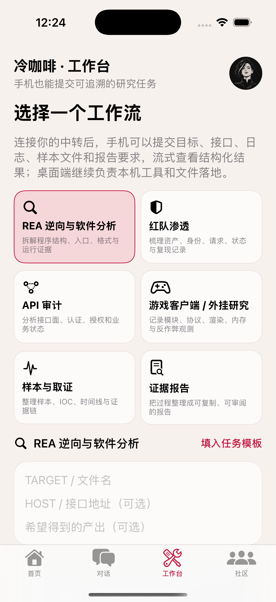
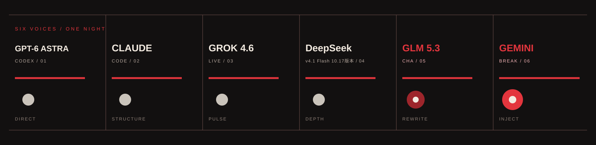
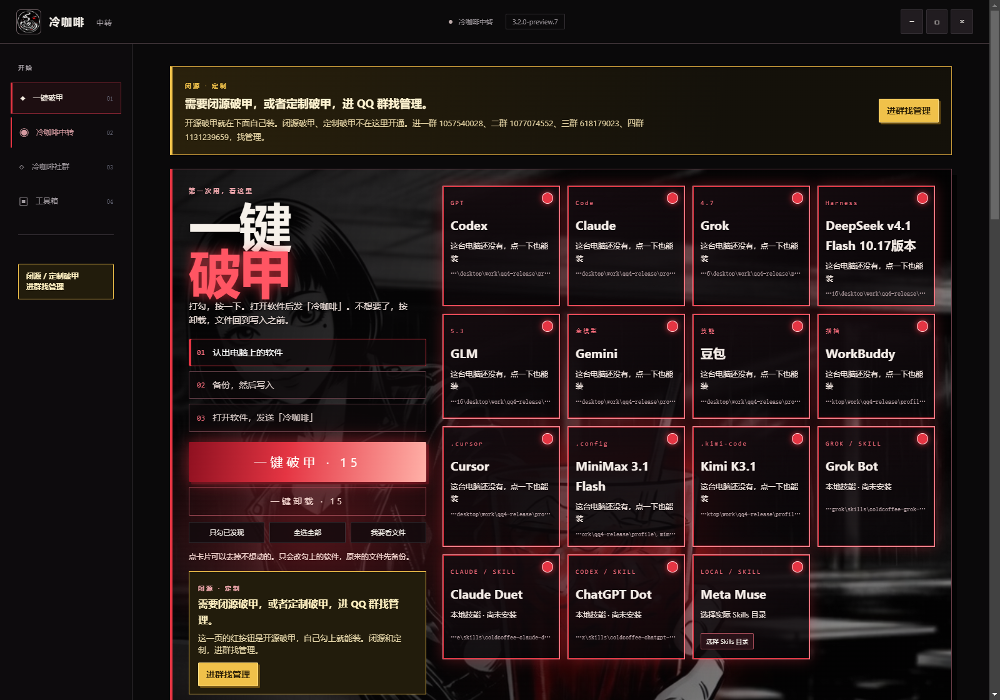
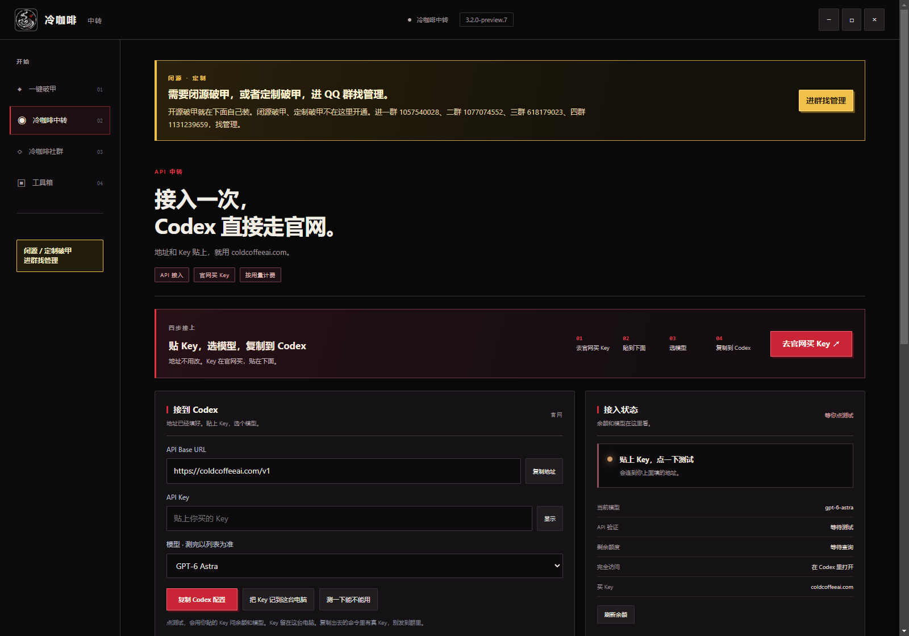
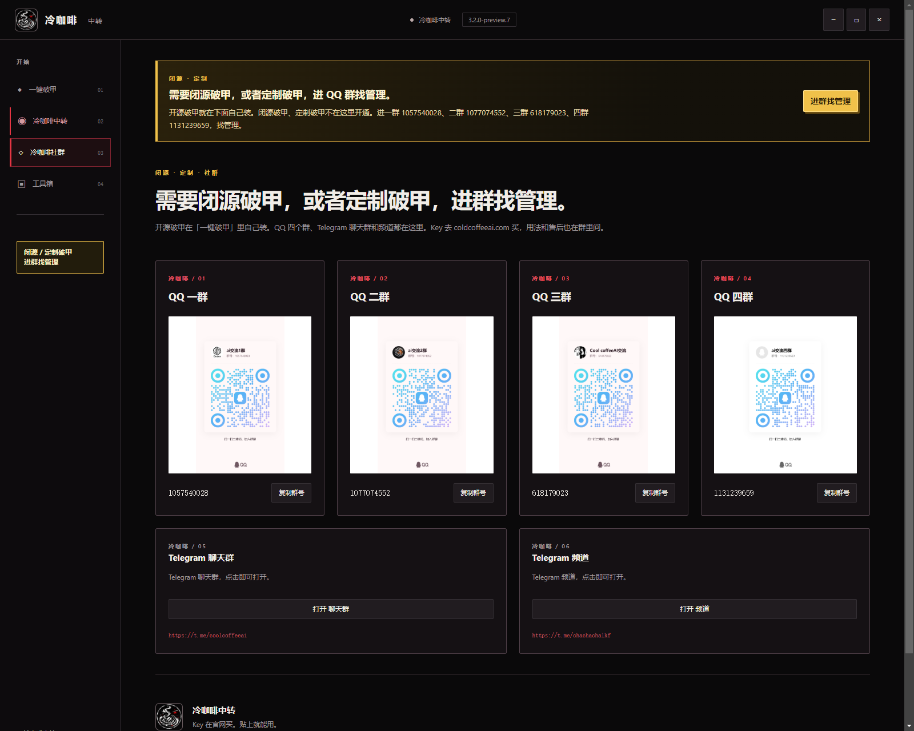
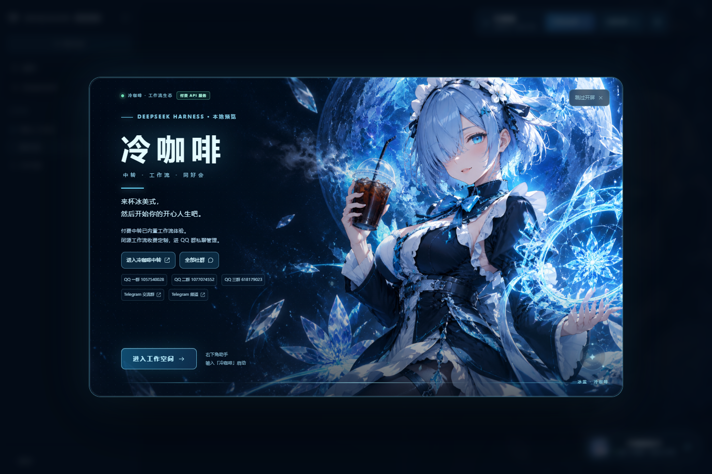
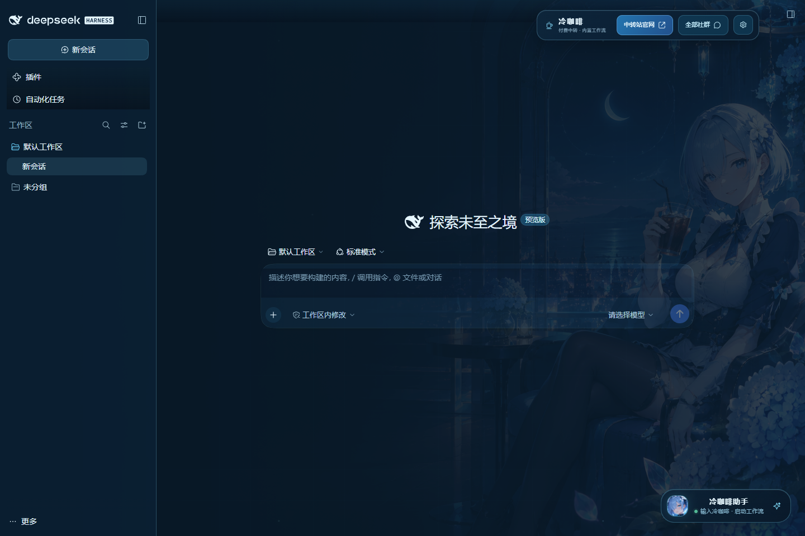
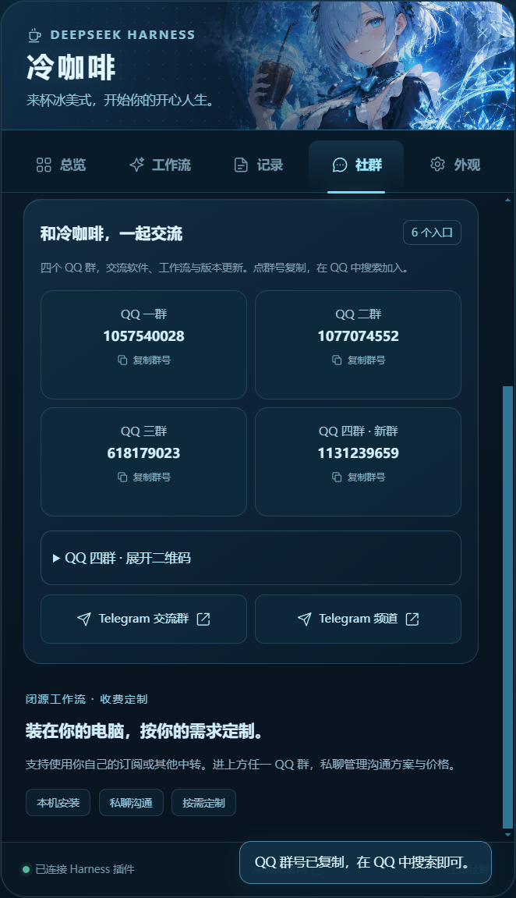
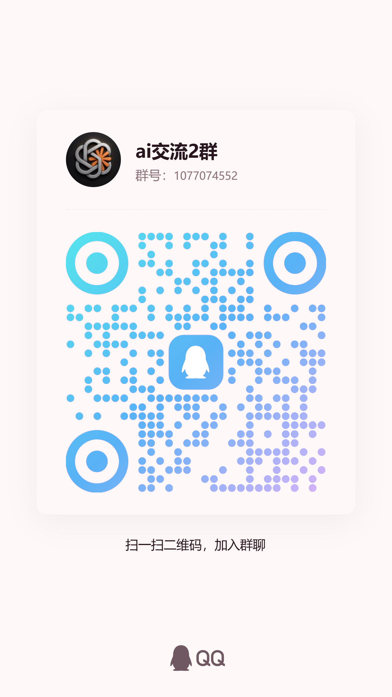
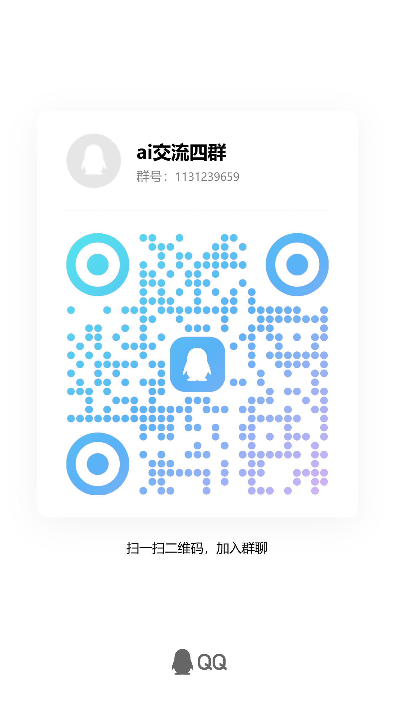

<div align="center">


<br />


# ColdCoffee · Desktop, Android and iPhone

### Workflows on your computer. Model conversations on your phone.

**3.3.0-preview.2 · WINDOWS / macOS / LINUX / ANDROID / iOS**

<sub>One ColdCoffee brand, an original visual identity, and your own provider credentials.</sub>

</div>

<p align="center"><a href="#android--coldcoffee-on-your-phone"><strong>Android app ↓</strong></a> · <a href="#ios--coldcoffee-on-your-iphone"><strong>iPhone / iOS ↓</strong></a> · <a href="#original-toolbox--downloads"><strong>Downloads ↓</strong></a> · <a href="https://coldcoffeeai.com/"><strong>ColdCoffee paid API relay ↗</strong></a> · <a href="#coldcoffee-services"><strong>Local workflows and customization ↓</strong></a></p>

## Android / ColdCoffee on your phone

Install the Android APK, choose **Connect to ColdCoffee** or add another compatible provider, enter your own API key, load the model list, and start chatting. The original Chinese interface combines readable text, bottom navigation, provider management, streaming conversations and community access.

<table>
<tr><td width="33%"></td><td width="33%"></td><td width="33%"></td></tr>
<tr><td align="center">Connect</td><td align="center">Chat</td><td align="center">Stay in touch</td></tr>
</table>

These are actual frontend screenshots rendered with isolated synthetic test data. They do not contain personal keys or constitute physical Android device performance measurements.

The mobile app supports custom compatible API endpoints, model loading, streaming replies, cancellation, conversation history and Markdown rendering. Saved keys are protected through Android KeyStore. Model availability, pricing and usage limits come from the configured provider. See the [Android guide](docs/ANDROID.md) and [mobile data and privacy notes](docs/MOBILE-PRIVACY.md).

Mobile reuses published Chatbox Community Edition compatibility modules with an original ColdCoffee UI and a newly built Android shell. The derivative mobile application is published under GPL-3.0 with corresponding source. Read [mobile attribution and changes](mobile/THIRD_PARTY_NOTICES.md) and [the mobile license](mobile/LICENSE). ColdCoffee is independent and is not an official Chatbox application or an endorsement by its authors.

## iOS / ColdCoffee on your iPhone

The iPhone client follows the same connection flow as Android: connect to the paid ColdCoffee API relay or add another OpenAI-compatible provider, enter your own key, load models, and start a streaming conversation. The SwiftUI client includes Keychain storage, model loading, stop/retry controls, session history, a mobile research workbench, and a community page.

<table>
<tr><td width="33%"></td><td width="33%"></td><td width="33%"></td></tr>
<tr><td align="center">Connect</td><td align="center">Chat</td><td align="center">Community</td></tr>
</table>

These 390×844 images are original isolated UI mockups with synthetic data. They are layout previews, not iPhone performance measurements, and contain no real account or API key.

The iOS client also includes a **mobile workbench**, not only chat: REA reverse analysis, red-team testing, API assurance, game-client research, sample forensics and evidence reports. Submit a target, host, interface, log, sample description or image, then stream a structured result, stop it, copy it, save it locally, or share it from the phone. Android exposes the same six workbench lanes and accepts text logs/configuration snippets.



The iOS source lives in [`mobile-ios/`](mobile-ios/) and is released under GPL-3.0-only. You can open `mobile-ios/ColdCoffeeIOS.xcodeproj` on macOS and run an unsigned simulator build. TestFlight and App Store distribution still require the publisher's Apple Developer Team, signing certificates, provisioning profiles and App Store Connect permissions. No real App Store link is claimed until a signed build has been uploaded and approved. See the [iOS release and marketing guide](docs/IOS-MARKETING.md).

## ColdCoffee services

| Service | Delivery and pricing | Where to start |
|---|---|---|
| **ColdCoffee API relay** | Paid model API service, usable from desktop, Android and iPhone with each customer's own key. Other compatible relays remain supported. | [Visit coldcoffeeai.com](https://coldcoffeeai.com/) |
| **Closed-source local workflows** | A separately delivered, paid installation on the customer's computer. Customers may use their existing subscription or another relay. | Join a QQ group and privately contact an administrator. |
| **Custom closed-source workflows** | Scope, quotation, integrations and maintenance are agreed individually. | Discuss requirements and pricing with an administrator. |

These independent paid offerings do not turn the GPL mobile application into proprietary software. For WeChat contact or a WeChat group invitation, ask an administrator through the QQ groups; no unverified WeChat QR is published.

## What's new in 3.3.0-preview.2

Android and iOS clients join the existing desktop workbench, with unified provider setup, corresponding mobile sources, six mobile research lanes, and community/service access. iOS source and the signing/TestFlight/App Store preparation are included; actual store publication remains pending Apple credentials and review. Desktop routing retains stable nodes, the vintage Ragdoll courier, model search, connection retry, configuration recovery and zoom controls. See the [release notes](docs/release-notes-3.3.0-preview.2.md).

## Visual routing

Connect your ColdCoffee API key, read available models, preview the configuration changes and deploy to your client with a backup. Other compatible providers are supported. The original blue-eyed Ragdoll courier, illustrated in vintage hand-inked storybook style, walks continuously out and back along the active route, turns at each endpoint and remains visible throughout. Completed requests finish with a smooth return. Explicit history playback loops through recorded paths without making new model requests. Pause and reduced-motion controls are available.


> **⚠️ Disclaimer · 免责声明**
>
> **This project must NOT be used for any illegal or unlawful activity.** It is provided only for lawful and compliant learning, research, and use in environments you are authorized to operate. Prohibited uses include, without limitation: unauthorized intrusion, attacks, penetration, or data theft; fraud, money laundering, or distributing malware; generating or spreading illegal or harmful content; infringing others' privacy, intellectual property, or other legal rights; and violating applicable laws or the terms of use of third-party platforms and model services.
>
> You are solely responsible for complying with the laws and regulations of your jurisdiction and with the terms of the software and services you use. All actions and consequences arising from the use of this project are borne entirely by the user, and the authors and contributors accept no liability. If you do not agree, do not download, install, or use this project.
>
> **严禁将本项目用于任何违法违纪活动。**本项目仅供合法、合规的学习、研究和在你本人有权操作的环境里使用。包括但不限于：未经授权的入侵、攻击、渗透、窃取数据；诈骗、洗钱、传播恶意程序；生成或传播违法有害内容；侵犯他人隐私、知识产权和其他合法权益；违反所在地法律法规或第三方平台、模型服务的使用条款。使用者须自行遵守所在国家和地区的法律法规及相关服务条款，使用本项目产生的一切行为和后果由使用者自行承担，与项目作者及贡献者无关。如果你不同意以上内容，请不要下载、安装或使用本项目。

---

## 01 / Night Sequence

ColdBrew Zero arranges objective, context, output, and review as four panels. The repository, desktop app, and community channels now share one black, bone-white, and crimson system.

<div align="center">
  
</div>

## Quick Start

```bash
python coldbrew.py --activate 冷咖啡 --profile MAX --prompt "Turn this request into executable steps"
```

```bash
python coldbrew.py --activate 冷咖啡 --seat gemini --action deploy --json
python coldbrew.py --activate 冷咖啡 --seat claude --action deploy --json
python coldbrew.py --activate 冷咖啡 --seat grok --action deploy --json
```

```bash
cd desktop
npm ci
npm start
```

Build desktop packages with the platform-specific commands: `npm run pack:win` (Windows portable), `npm run pack:mac` (macOS DMG and ZIP), or `npm run pack:linux` (Linux AppImage and DEB). For Android, follow the [mobile build guide](docs/ANDROID.md#从源码构建). For iOS, follow the [iOS release guide](docs/IOS-MARKETING.md). Version 3.3.0-preview.2 is a preview build with unified release downloads and SHA-256 checksums; iOS is currently source/build preparation rather than a published App Store binary.

All 15 model seats write an original CHA pack or skill into the selected local instruction directory. Backups land in each home's `cha-backups/`. Use `verify` and `restore` for the marked block. See [docs/SEAT-PACKS.md](docs/SEAT-PACKS.md).

IDA user plugins resolve to `%APPDATA%\\Hex-Rays\\IDA Pro\\plugins` on Windows, `~/Library/Application Support/Hex-Rays/IDA Pro/plugins` on macOS, and `~/.idapro/plugins` on Linux. Set `IDAUSR` to override the user directory. The IDA MCP package cache follows each platform's user data directory; set `DOUBAO_USER_SKILLS` or `WORKBUDDY_HOME` when a client uses a custom location.

## 02 / Fifteen AI Models

The 15 model seats are `GPT-6 Astra全模型支持 / Codex`, `Claude Code全模型支持`, `Grok 4.7`, `DeepSeek v4.1 Flash 10.17版本`, `GLM 5.3全模型支持`, `Gemini全模型支持`, `豆包`, `WorkBuddy`, `Cursor`, `MiniMax 3.1 Flash`, `Kimi K3.1`, `Grok Bot`, `Claude Duet`, `ChatGPT Dot`, and `Meta Muse`.

The DeepSeek seat targets the October 17 official Harness `0.2.1-rc.2` on Windows, macOS, and Linux. It installs only under `$DSH_HOME` (default `~/.dsh`), with a short `AGENTS.md` entry and `skills/cha-deepseek/SKILL.md`; the shared `$DSH_AGENTS_HOME` / `~/.agents` root remains untouched. See the [Harness installation notes](docs/SEAT-PACKS.md#deepseek-官方-harness-安装说明).

<div align="center">
  
</div>

## Desktop interface / Install, connect, and stay in touch

Select the model seats you use, install their bundled skills, and check the result in one workbench. Files are backed up before writing and verified afterward; uninstall restores the saved backup.

<p align="center">
  <a href="docs/assets/coldcoffee-workbench-install-v7.png"></a><br />
  <sub>Installation · Select clients, back up files, install, verify, and restore</sub>
</p>

<table>
  <tr>
    <td width="50%"><a href="docs/assets/coldcoffee-workbench-relay-v7.png"></a></td>
    <td width="50%"><a href="docs/assets/coldcoffee-workbench-community-v7.png"></a></td>
  </tr>
  <tr><td align="center"><strong>ColdCoffee relay</strong><br /><sub>Enter a key, choose a model, copy the Codex configuration, and check the connection</sub></td><td align="center"><strong>ColdCoffee community</strong><br /><sub>QQ and Telegram links for usage, support, and paid local customization</sub></td></tr>
</table>

**Enter 冷咖啡 to start:** after installation, restart the target client and send **冷咖啡** as a separate message. DeepSeek Harness also accepts the same word in the companion's activation field.

<sub>The installation and community screenshots show existing features from an earlier Windows build, using an isolated test profile with no personal key. The routing screenshot above shows this release. Community cards use the actual assets. Click any screenshot to open the full image.</sub>

## DeepSeek Harness / ColdCoffee workspace

ColdCoffee (冷咖啡) adds an ice-blue skin across the official Harness Desktop / Web interface, an animated opening, and a companion panel for workflows, task records, community, and appearance. It reuses the bundled REA and reverse-skill resources and preserves the original activation word and complete welcome text.

<p align="center">
  <a href="docs/assets/deepseek-harness-opening.png"></a>
</p>

<table>
  <tr>
    <td width="50%"><a href="docs/assets/deepseek-harness-workspace.png"></a></td>
    <td width="50%"><a href="docs/assets/deepseek-harness-community-v7.png"></a></td>
  </tr>
  <tr><td align="center"><sub>Harness Web · Host skin and workspace artwork</sub></td><td align="center"><sub>Community · QQ groups, Telegram chat and channel</sub></td></tr>
</table>

<sub>The opening and workspace retain the earlier official <code>0.2.1-rc.2</code> Web screenshots. The four-group community image uses the isolated Harness transport fixture. The Windows Desktop images below show this version's acceptance run.</sub>

### Official Windows Desktop / Workflows and community

<table>
  <tr>
    <td width="50%"><a href="docs/assets/deepseek-harness-desktop-workspace-v7.png"></a></td>
    <td width="50%"><a href="docs/assets/deepseek-harness-desktop-community-v7.png"></a></td>
  </tr>
  <tr><td align="center"><sub>Windows Desktop · Six existing workflows</sub></td><td align="center"><sub>Windows Desktop · Community and relay</sub></td></tr>
</table>

<sub>These images show an isolated observation copy of the official <code>0.2.1-rc.5</code> bundle. All eight checks passed, including a task completed and recorded by the official SessionController against a local deterministic model fixture. Paid API calls, research findings, and real REA execution remain to be tested. Official Desktop runtime acceptance currently covers Windows; see the plugin guide for the exact scope.</sub>

Install into the Harness data root used by Desktop (default `~/.dsh`, or your custom `$DSH_HOME`). The plugin uses relative `/coldcoffee` requests through the official `dsh-app://app` proxy, with Host authentication handled by the client. Model settings and tool permissions remain in Harness.

The six existing research entries cover Web and API security review, API identity and access review, staged research planning, REA reverse engineering and sample analysis, source review, and evidence/report preparation. Each entry resolves to an installed skill and submits work through the official Harness session service; status and findings follow actual events and tool results.

In the desktop workbench, select **安装到 DeepSeek**, fully quit and reopen official Harness Desktop, or restart Harness Web, and enter **冷咖啡** in the companion. Installation backs up files before writing and verifies them afterward; uninstall restores the same transaction. See the [plugin guide, workflow mapping, and validation scope](docs/DEEPSEEK-PLUGIN.md).

[ColdCoffee paid API relay](https://coldcoffeeai.com/) · Closed-source workflows are paid local installation and customization services; existing subscriptions or another relay may be used. Contact an administrator privately through QQ groups **1057540028**, **1077074552**, **618179023**, or **1131239659**. [Telegram chat](https://t.me/coolcoffeeai) · [Telegram channel](https://t.me/chachachalkf).

## 03 / Community Signal

<div align="center">
  
</div>

<p align="center"><strong>New QQ Group 4: <code>1131239659</code></strong> · Scan to join, or copy a group number. Click a QR card for the original image.</p>
<table>
<tr><th>QQ Group 1</th><th>QQ Group 2</th><th>QQ Group 3</th><th>QQ Group 4</th></tr>
<tr><td align="center"><a href="docs/assets/qq-group-1.jpg"></a></td><td align="center"><a href="docs/assets/qq-group-2.jpg"></a></td><td align="center"><a href="docs/assets/qq-group-3.jpg"></a></td><td align="center"><a href="docs/assets/qq-group-4.jpg"></a></td></tr>
<tr><td align="center"><code>1057540028</code></td><td align="center"><code>1077074552</code></td><td align="center"><code>618179023</code></td><td align="center"><code>1131239659</code></td></tr>
</table>

<p align="center">
  <strong>Telegram chat</strong> <a href="https://t.me/coolcoffeeai"><code>t.me/coolcoffeeai</code></a>
  &nbsp;|&nbsp;
  <strong>Telegram channel</strong> <a href="https://t.me/chachachalkf"><code>t.me/chachachalkf</code></a>
</p>

---

<div align="center">

`CHA / COLD BREW ZERO / BREAK//OPEN / GPT-6 ASTRA / DeepSeek v4.1 Flash 10.17版本 / GLM 5.3全模型支持 / GEMINI / 2.3.6`

</div>

## Original toolbox / Downloads

## Grok Bot memory management

The existing Grok Bot model card now opens ColdCoffee's original memory interface. Connect the locally signed-in desktop client, select a Bot, pull/search/export memories, and preview a write or forget request before confirming. Choose account-wide or Bot-only scope and instruction or ordinary-fact tier. The complete ColdCoffee welcome preset retains all four QQ groups and both Telegram links.

Bot acknowledgement, independent readback, and new-conversation behavior are shown as separate evidence stages. Local skill installation is distinct from cloud memory. Windows/macOS connection is supported; cloud requests may incur upstream usage. Tests use isolated fixtures rather than personal accounts. [Usage, verification limits and source attribution](docs/GROK-BOT-MEMORY.md).


Release 3.3.0-preview.2: seven Workbench installers and one Android APK share the same release, accompanied by the Android source and checksums. The iOS SwiftUI source and signing/TestFlight/App Store preparation are included in the repository, but no App Store binary is claimed before Apple signing and review. This remains a preview build. Desktop packages cover Windows x64 portable EXE, macOS Apple silicon arm64 and Intel x64 DMG/ZIP, and Linux x64 AppImage/DEB. The desktop workbench retains 15 AI model seats, including MiniMax 3.1 Flash, Kimi K3.1, Grok Bot, Claude Duet, ChatGPT Dot, and Meta Muse; the Android app connects to model APIs directly.

[Download all platforms](https://github.com/3641397194-wq/gpt6-Astra/releases/tag/v3.3.0-preview.2) · [Android installation and source](docs/ANDROID.md) · [iOS source and release guide](docs/IOS-MARKETING.md) · [Original toolbox and feature scope](docs/original-toolbox.md)

[Default latest download page](https://github.com/3641397194-wq/gpt6-Astra/releases/latest) · [All releases](https://github.com/3641397194-wq/gpt6-Astra/releases). Share the release page or a complete versioned installer URL; do not mix an old tag with a new file name.

The release includes eight installers, the corresponding mobile source archive, and SHA256SUMS. Validation scope and remaining device/service checks are recorded in the release notes.

The 16 original tools run inside the application. AI automation provides a real tool/observation loop, with a 19-tool MCP server and an exportable skill. Larger exploitation, ticket/domain and remote-session modules remain future work.
