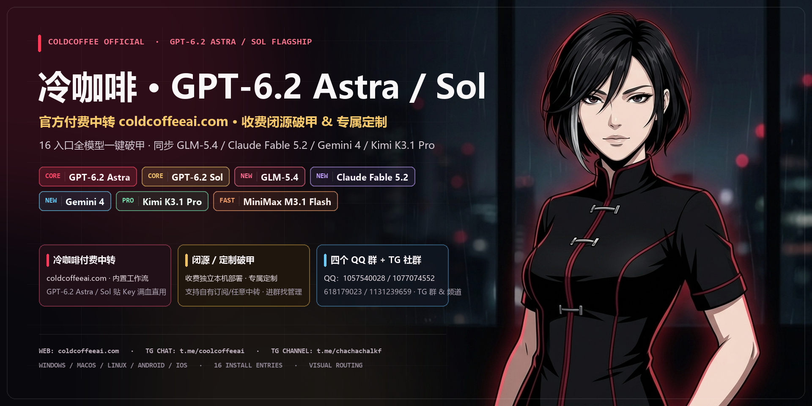
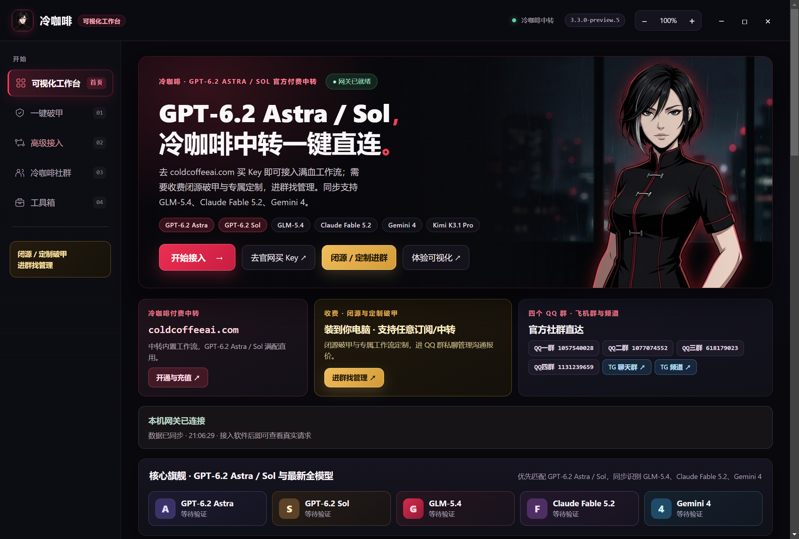
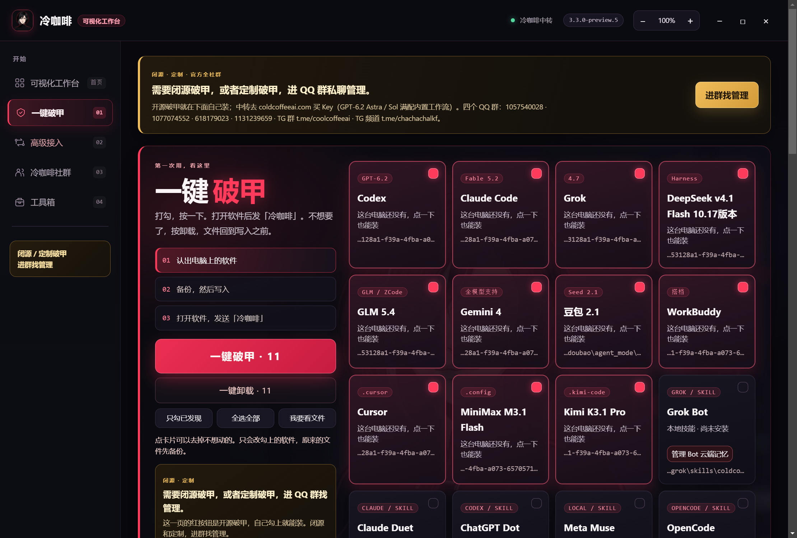
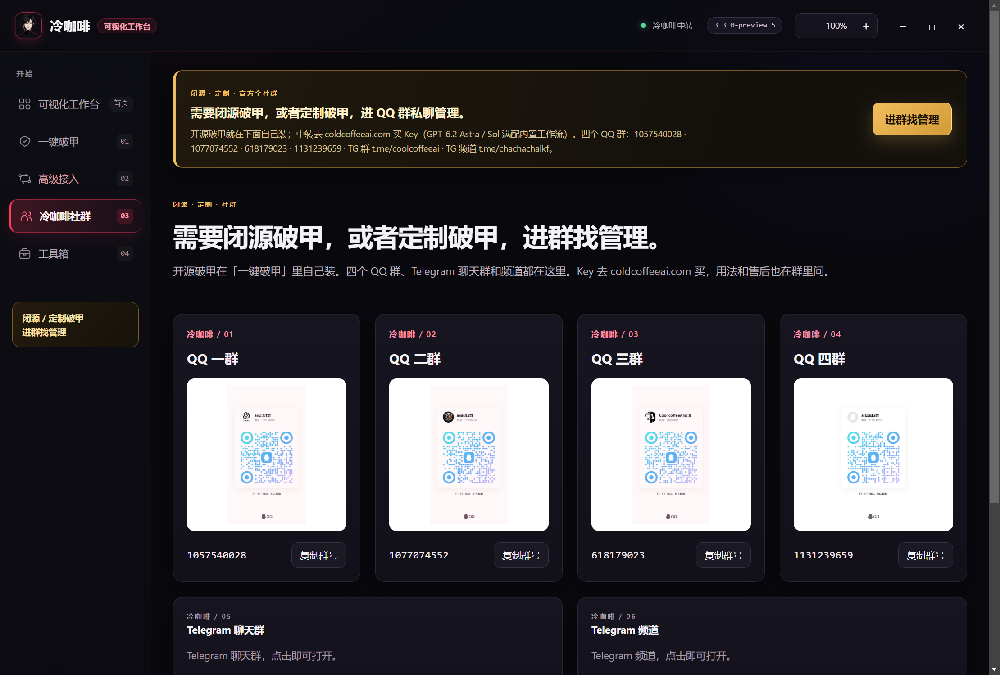
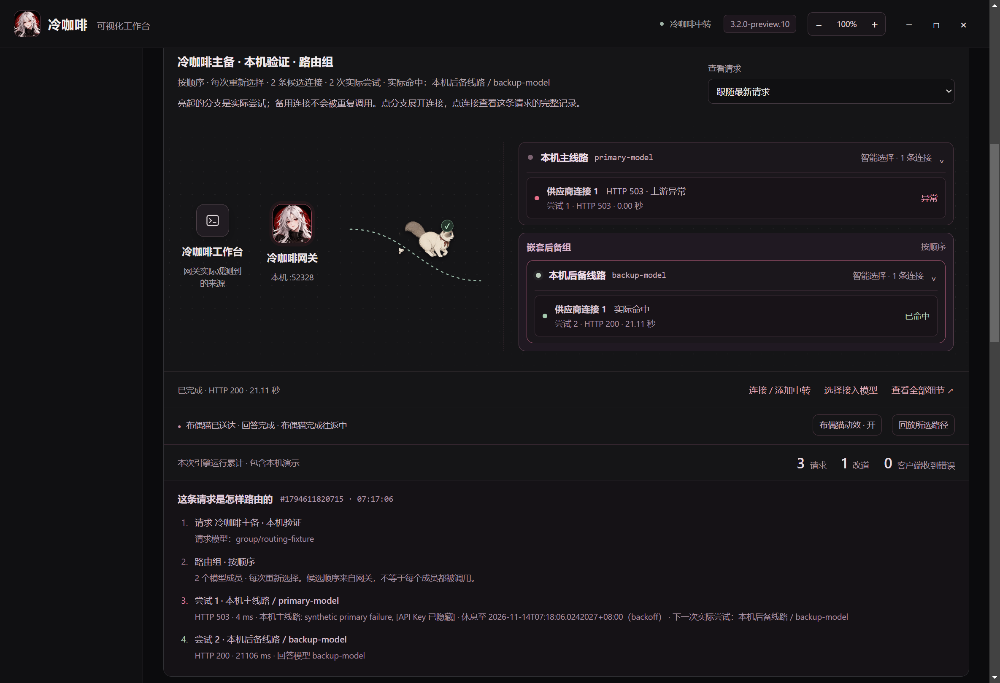
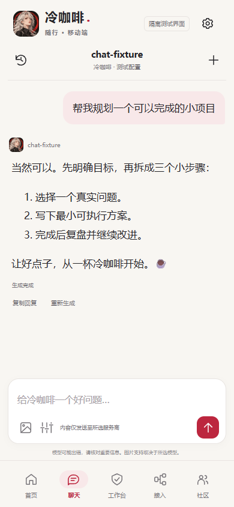
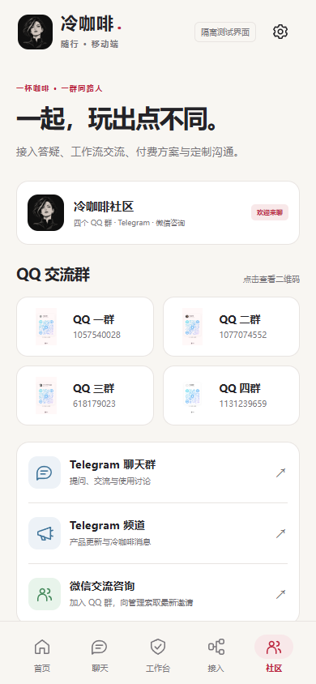
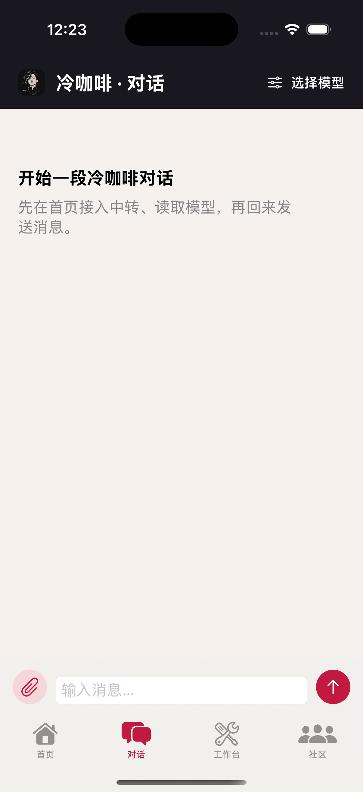
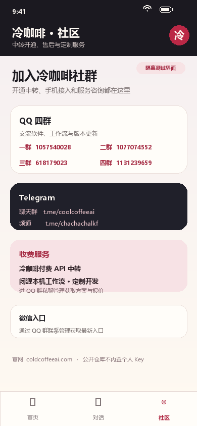

 

# ColdCoffee · GPT-6.2 Astra / Sol

### Official Paid API Relay · Closed-Source & Custom Workflows · 16-Entry Multi-Model Workbench

Centered on **GPT-6.2 Astra** and **GPT-6.2 Sol** with the **ColdCoffee Paid API Relay (`coldcoffeeai.com`)**, plus paid **closed-source local workflows** and **bespoke custom workflows**. Updated across desktop and mobile for **GLM 5.4 (`glm-5.4`)**, **Claude Fable 5.2**, **Gemini 4**, **Kimi K3.1 Pro**, **MiniMax M3.1 Flash**, **Doubao 2.1**, and **OpenCode**.

**Desktop 3.3.0-preview.5 · Android 3.3.0-preview.6 · iOS development build 3.3.0-preview.3**

<a href="https://coldcoffeeai.com/"><strong>🔥 ColdCoffee Paid API Relay ↗</strong></a> · <a href="#coldcoffee-services"><strong>💎 Closed-Source & Custom Workflows ↓</strong></a> · <a href="#03--community-signal"><strong>💬 4 QQ Groups & Telegram ↓</strong></a> · <a href="#original-toolbox--downloads"><strong>⬇ Downloads ↓</strong></a>

<a href="#desktop-interface--install-connect-and-stay-in-touch">Redesigned Desktop UI ↓</a> · <a href="#02--16-installation-entries">16 Installation Entries ↓</a> · <a href="#android--coldcoffee-on-your-phone">Android ↓</a> · <a href="#ios--coldcoffee-on-your-iphone">iPhone / iOS ↓</a>

## ColdCoffee services

| Service | Delivery and pricing | Where to start |
|---|---|---|
| **ColdCoffee Paid API Relay** | Flagship **GPT-6.2 Astra / GPT-6.2 Sol** plus latest synced models with built-in relay workflow experience across desktop, Android, and iPhone. | [Visit coldcoffeeai.com ↗](https://coldcoffeeai.com/) |
| **Closed-Source Local Workflows** | Paid standalone local installation delivered to the customer's computer. Works with your own subscription or any relay. | Join any QQ group below and message an administrator. |
| **Custom Closed-Source Workflows** | Tailored architecture, workflow engineering, quotation, and maintenance for your exact use case. | Contact an administrator in our QQ groups or Telegram. |
| **Official Community** | **QQ Groups:** `1057540028` · `1077074552` · `618179023` · `1131239659` | <a href="https://t.me/coolcoffeeai">Telegram Chat ↗</a> · <a href="https://t.me/chachachalkf">Telegram Channel ↗</a> |

These independent paid offerings stay cleanly separate from the GPL mobile client. For WeChat contact, ask an administrator in the QQ groups.

## Desktop interface / Noir Crimson Flagship Redesign

The redesigned desktop workbench unifies all pages under a sleek **Noir Crimson** obsidian interface, putting **GPT-6.2 Astra / Sol**, `coldcoffeeai.com`, **closed-source / custom services**, **all 4 QQ groups + Telegram chat & channel**, and all **16 installation entries** front and center.

   
  Visual Home · GPT-6.2 Astra / Sol flagship bar, relay CTA, VIP custom card & all community links

   
  One-Click Installer · Unified 16-entry grid synced to GLM 5.4, Claude Fable 5.2, Gemini 4, Kimi K3.1 Pro, MiniMax M3.1 Flash & OpenCode

<table>
  <tr>
    <td width="50%"></td>
    <td width="50%"></td>
  </tr>
  <tr><td align="center"><strong>ColdCoffee Relay</strong> GPT-6.2 Astra / Sol & OpenCode setup</td><td align="center"><strong>ColdCoffee Community</strong> Four QQ QR cards, Telegram chat & channel</td></tr>
</table>

<strong>OpenCode setup:</strong> OpenCode is entry #16 in the unified installer grid, and can also be wired through the Visual Workbench setup wizard with config preview, backup, and restore.

## Visual routing

Connect your ColdCoffee API key, read available models, preview configuration changes, and watch the original hand-inked blue-eyed Ragdoll courier walk live request paths with nested failover and context treemap inspection.

## 02 / 16 installation entries

| # | Model or client | 3.3.0-preview.5 desktop |
|---|---|---|
| 01 | **GPT-6.2 Astra / Sol · Codex** | Included |
| 02 | **Claude Fable 5.2 / all models** | Included |
| 03 | Grok 4.7 | Included |
| 04 | DeepSeek v4.1 Flash (October 17 version) | Included |
| 05 | **GLM 5.4 (all supported models)** | Included |
| 06 | **Gemini 4 (all supported models)** | Included |
| 07 | **豆包 2.1 (Doubao Seed 2.1)** | Included |
| 08 | WorkBuddy | Included |
| 09 | Cursor | Included |
| 10 | **MiniMax M3.1 Flash** | Included |
| 11 | **Kimi K3.1 Pro** | Included |
| 12 | Grok Bot | Included |
| 13 | Claude Duet | Included |
| 14 | ChatGPT Dot | Included |
| 15 | Meta Muse | Included |
| 16 | [OpenCode](#opencode) (client) | Included; relay setup previews local config |

## Android / ColdCoffee on your phone

Install the Android APK, connect to ColdCoffee (`coldcoffeeai.com`) or any compatible provider, prioritize **GPT-6.2 Astra / Sol** and latest synced models, chat with streaming replies, or run the six mobile research workbench lanes. See the [Android guide](docs/ANDROID.md) and [mobile privacy notes](docs/MOBILE-PRIVACY.md).

<table>
<tr><td width="33%"></td><td width="33%"></td><td width="33%"></td></tr>
<tr><td align="center">Connect</td><td align="center">Chat</td><td align="center">Community & Services</td></tr>
</table>

## iOS / ColdCoffee on your iPhone

SwiftUI native client with Keychain storage, GPT-6.2 Astra / Sol & multi-model support, streaming chat, six-lane mobile research workbench, and community hub. Source lives in [`mobile-ios/`](mobile-ios/) under GPL-3.0-only. See the [iOS release guide](docs/IOS-MARKETING.md).

<table>
<tr><td width="33%"></td><td width="33%"></td><td width="33%"></td></tr>
<tr><td align="center">Connect</td><td align="center">Chat</td><td align="center">Community</td></tr>
</table>

## DeepSeek Harness & Grok Bot memory

ColdCoffee ships an ice-blue companion plugin for DeepSeek Harness Web & Windows Desktop ([guide](docs/DEEPSEEK-PLUGIN.md)) and an original cloud memory manager for Grok Bot ([guide](docs/GROK-BOT-MEMORY.md)).

## 03 / Community Signal

<strong>Four Official QQ Groups + Telegram Chat & Channel</strong>

<table>
<tr><th>QQ Group 1</th><th>QQ Group 2</th><th>QQ Group 3</th><th>QQ Group 4</th></tr>
<tr><td align="center"></td><td align="center"></td><td align="center"></td><td align="center"></td></tr>
<tr><td align="center"><code>1057540028</code></td><td align="center"><code>1077074552</code></td><td align="center"><code>618179023</code></td><td align="center"><code>1131239659</code></td></tr>
</table>

  <strong>Telegram chat</strong> <a href="https://t.me/coolcoffeeai"><code>t.me/coolcoffeeai</code></a>
  &nbsp;|&nbsp;
  <strong>Telegram channel</strong> <a href="https://t.me/chachachalkf"><code>t.me/chachachalkf</code></a>

## Original toolbox / Downloads

| Desktop installer | Format | 3.3.0-preview.5 availability |
|---|---|---|
| Windows x64 | [Portable EXE](https://github.com/3641397194-wq/gpt6-Astra/releases/download/v3.3.0-preview.5/ColdCoffee-Workbench-Windows-3.3.0-preview.5-x64.exe) | 16 installation entries; includes OpenCode |
| macOS Apple silicon (arm64) | [DMG](https://github.com/3641397194-wq/gpt6-Astra/releases/download/v3.3.0-preview.5/ColdCoffee-Workbench-macOS-arm64-3.3.0-preview.5.dmg), [ZIP](https://github.com/3641397194-wq/gpt6-Astra/releases/download/v3.3.0-preview.5/ColdCoffee-Workbench-macOS-arm64-3.3.0-preview.5.zip) | 16 installation entries; includes OpenCode |
| macOS Intel (x64) | [DMG](https://github.com/3641397194-wq/gpt6-Astra/releases/download/v3.3.0-preview.5/ColdCoffee-Workbench-macOS-x64-3.3.0-preview.5.dmg), [ZIP](https://github.com/3641397194-wq/gpt6-Astra/releases/download/v3.3.0-preview.5/ColdCoffee-Workbench-macOS-x64-3.3.0-preview.5.zip) | 16 installation entries; includes OpenCode |
| Linux x86_64 | [AppImage](https://github.com/3641397194-wq/gpt6-Astra/releases/download/v3.3.0-preview.5/ColdCoffee-Workbench-Linux-x86_64-3.3.0-preview.5.AppImage), [DEB](https://github.com/3641397194-wq/gpt6-Astra/releases/download/v3.3.0-preview.5/ColdCoffee-Workbench-Linux-amd64-3.3.0-preview.5.deb) | 16 installation entries; includes OpenCode |

[Desktop release](https://github.com/3641397194-wq/gpt6-Astra/releases/tag/v3.3.0-preview.5) · [Android APK](https://github.com/3641397194-wq/gpt6-Astra/releases/download/android-v3.3.0-preview.6/ColdCoffee-Mobile-Android-3.3.0-preview.6.apk) · [Corresponding Android source](https://github.com/3641397194-wq/gpt6-Astra/releases/download/android-v3.3.0-preview.6/ColdCoffee-Mobile-Source-3.3.0-preview.6.zip) · [Android installation guide](docs/ANDROID.md)

iOS development downloads stay on 3.3.0-preview.3: [corresponding iOS source](https://github.com/3641397194-wq/gpt6-Astra/releases/download/v3.3.0-preview.3/ColdCoffee-iOS-Source-3.3.0-preview.3.zip), [unsigned development app](https://github.com/3641397194-wq/gpt6-Astra/releases/download/v3.3.0-preview.3/ColdCoffee-iOS-Unsigned-3.3.0-preview.3.zip), and [iOS checksums](https://github.com/3641397194-wq/gpt6-Astra/releases/download/v3.3.0-preview.3/SHA256SUMS-iOS.txt) ([earlier release assets](https://github.com/3641397194-wq/gpt6-Astra/releases/tag/v3.3.0-preview.3)).

Disclaimer · 免责声明

> **This project must NOT be used for any illegal or unlawful activity.** It is provided only for lawful and compliant learning, research, and use in environments you are authorized to operate. You are solely responsible for complying with applicable laws and service terms.
>
> **严禁将本项目用于任何违法违纪活动。**本项目仅供合法合规学习研究与本人有权操作的环境使用，使用产生的一切后果由使用者自行承担。

---

`CHA / COLD BREW ZERO / BREAK//OPEN / GPT-6.2 ASTRA / SOL / GLM 5.4全模型支持 / CLAUDE FABLE 5.2 / GEMINI 4 / DeepSeek v4.1 Flash 10.17版本 / 3.3.0-preview.5`

