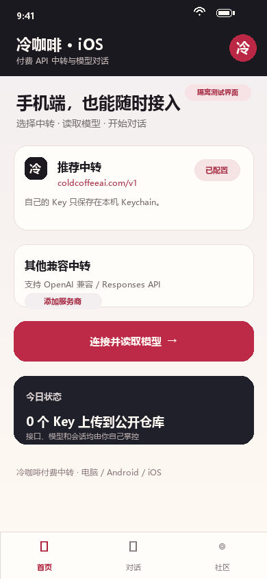

<div align="center">
  
  <h1>ColdCoffee Workbench</h1>
  <p><strong>Configure models on your computer. Chat from your phone.</strong></p>
  <p><a href="#opencode-development-preview">OpenCode setup</a> · <a href="#downloads">Downloads</a> · <a href="#coldcoffee-services">Services</a> · <a href="#coldcoffee-community">Community</a> · <a href="README.md">简体中文</a></p>
</div>

## OpenCode development preview

Choose OpenCode in the desktop workbench's relay setup. Use ColdCoffee or add an API endpoint from another compatible provider.

1. Enter your API address and key.
2. Load the model catalog and select a model. The workbench keeps the exact model ID returned by the provider.
3. Preview the target config and confirm the write. The workbench backs up the file so you can restore it later.

[](docs/assets/coldcoffee-opencode-workbench.png)

OpenCode setup is available in the desktop development preview. The published `3.3.0-preview.3` installers predate this feature. OpenCode is a client option. The desktop workbench has fifteen model seats, including GPT-6.2 Astra and Sol as catalog highlights where available from your provider.

## Desktop routing

See the route, attempts, response times, and failover for each request. The Ragdoll cat follows the request path. Pause the animation or replay earlier routes.

[](docs/assets/coldcoffee-routing-v10.png)

[Desktop relay guide](docs/RELAY-API.md) · [DeepSeek Harness plugin](docs/DEEPSEEK-PLUGIN.md) · [Grok Bot memory interface](docs/GROK-BOT-MEMORY.md) · [ColdCoffee toolbox](docs/original-toolbox.md)

## Android and iPhone

Add ColdCoffee or your own compatible relay, choose a model, and start a streaming conversation. Both apps include conversation history, a research workspace, and community links.

| Android | iPhone |
| --- | --- |
| <a href="docs/assets/coldcoffee-mobile-home.png"></a> | <a href="docs/assets/coldcoffee-ios-home.png"></a> |
| [Installation and connection guide](docs/ANDROID.md) | [SwiftUI build and distribution guide](docs/IOS-MARKETING.md) |

The Android capture shows the app in an isolated test environment. The iPhone capture comes from an iOS simulator. [Mobile privacy documentation](docs/MOBILE-PRIVACY.md).

## Downloads

Release 3.3.0-preview.3: seven desktop packages for Windows, macOS and Linux, the Android APK and corresponding source, and three iOS development attachments. The iOS archive requires Apple signing to install on an iPhone. App Store and TestFlight availability is pending.

[Download all platforms](https://github.com/3641397194-wq/gpt6-Astra/releases/tag/v3.3.0-preview.3) · [All releases](https://github.com/3641397194-wq/gpt6-Astra/releases) · [Release validation](docs/release-notes-3.3.0-preview.3.md)

<details>
<summary>Run the desktop workbench from source</summary>

```sh
cd desktop
npm ci
npm start
```

</details>

## ColdCoffee services

| Service | How it works |
| --- | --- |
| [ColdCoffee API relay](https://coldcoffeeai.com/) | Paid model access using your own key on desktop or mobile. The relay lists model availability, quota, and pricing. |
| Closed-source local workflows | Separately paid installation on your computer. Works with your existing subscription or another compatible relay. Privately contact a QQ group administrator. |
| Custom closed-source workflows | Privately contact a QQ group administrator for a quote based on your request, delivery scope, and maintenance needs. |

## ColdCoffee community


Use the QQ groups to reach an administrator for support, paid workflows, or a WeChat invitation.

| QQ group 1 | QQ group 2 | QQ group 3 | QQ group 4 |
| --- | --- | --- | --- |
| [1057540028](docs/assets/qq-group-1.jpg) | [1077074552](docs/assets/qq-group-2.jpg) | [618179023](docs/assets/qq-group-3.jpg) | [1131239659](docs/assets/qq-group-4.jpg) |

<a href="https://t.me/coolcoffeeai">Telegram chat</a> · <a href="https://t.me/chachachalkf">Telegram channel</a>

## Licensing and attribution

The desktop project's original code is MIT-licensed. The mobile apps include corresponding source. The Android app incorporates published Chatbox Community Edition compatibility modules with an independent ColdCoffee interface.

[Desktop MIT license](LICENSE) · [Android GPL-3.0 license](mobile/LICENSE) · [iOS GPL-3.0 license](mobile-ios/LICENSE) · [Third-party notices](THIRD_PARTY_NOTICES.md) · [Mobile upstream attribution](mobile/THIRD_PARTY_NOTICES.md)
