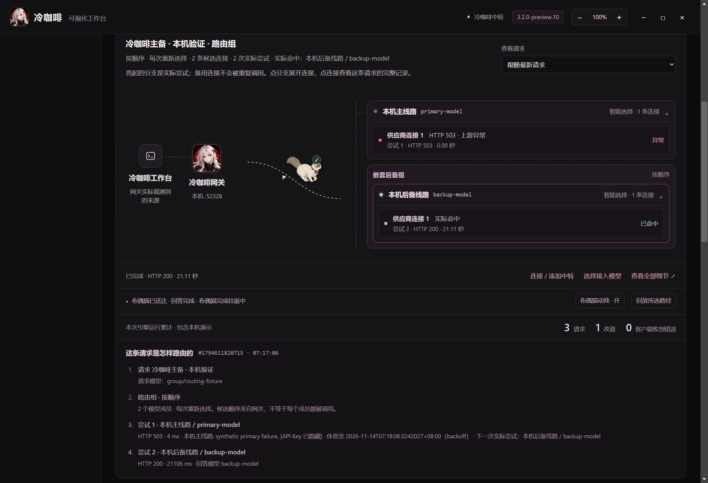

# 冷咖啡工作台 3.2.0-preview.10

本版集中优化路由可视化、中转连接和窗口缩放，保留当前女生主视觉、中古风布偶猫、十五个模型席位、既有技能与 DeepSeek 插件，以及四个 QQ 群和 Telegram 入口。

## 路由与接入

- 流式请求更新复用路由节点，布偶猫使用连续位移，减少反复布局造成的卡顿；待命、真实传输和历史回放分别显示。
- 模型选择加入搜索，可按模型名或中转名称筛选，保留已选模型。
- 连接状态与数据同步状态明确显示；失败可一键重试，恢复后清除过期错误。
- 向导增加操作互斥与结果代次校验，关闭后清空 Key 输入；旧操作返回时不会污染重新打开的界面。
- 模型变化使旧配置预览失效，避免把过期计划应用到另一个模型。网关未就绪时不再复制无效地址。

## 稳定性

- 中转列表或网关设置损坏时，先原样备份再恢复默认状态，并在界面提醒。不会重置外部客户端配置。
- 防止启动期间重复连接或重复发送；停止请求也覆盖启动预热阶段。
- 密钥加密或写盘失败时保留原 Key 与原密文。中转配置提交失败会回滚网关与本地状态；恢复失败则停用网关并要求重新验证。
- 过滤模型接口返回的空 ID，避免下次启动误判配置损坏。
- 缩放保存失败时，当前窗口仍按实际档位工作并提示保存状态；问题解决后可重试，保留 80%–200% 档位。

## 使用

打开「可视化中转」→ 填入自己的接口与 Key → 读取并搜索模型 → 预览接入配置 → 确认写入。没有 Key 时可使用本机演示查看路由过程；演示和历史回放不会调用付费模型。查看真实用量和故障，请以请求记录为准。

配置恢复提醒表示旧文件已保存为同目录 `.bak-corrupt-*` 备份；重新添加中转后核对模型和客户端接入。缩放保存失败时检查软件资料目录的可写性，再点同一缩放档位重试。

## 下载与验证

[最新版下载](https://github.com/3641397194-wq/gpt6-Astra/releases/latest) · [本版固定入口](https://github.com/3641397194-wq/gpt6-Astra/releases/tag/v3.2.0-preview.10)

Windows x64、macOS Apple silicon / Intel、Linux x64 共七个安装包经各自平台检查后发布，并附 `SHA256SUMS.txt`。本版仍是预览构建；GitHub Latest 用于提供统一下载入口。

测试使用独立资料目录与合成接口；测试结果不代表第三方付费服务的可用性。原依赖版本与必要许可声明随包保留。

## 本机验收

- Windows 源码检查：243 项通过，1 项 POSIX 权限语义测试在 Windows 跳过。
- Windows 打包版：真实网关主备切换、布偶猫连续往返、历史回放、暂停与减少动效、125% 缩放及窄窗口通过；本机合成接口，无付费请求。
- 缩放写盘失败、同档位重试与应用重启恢复通过。模型搜索、向导旧结果失效与恢复确认通过。
- 原生网关配置恢复、事务回滚与重新验证门槛通过。源码与应用归档扫描未发现常见凭据格式，个人资料目录及运行密钥文件未打入应用归档。
- 生产 npm 依赖审计未报告已知漏洞；这不覆盖整个运行时与所有开发依赖。

图中为独立资料目录下的合成主备接口，展示一次真实的本机 503 → 200 切换，不代表任何线上中转的状态。
